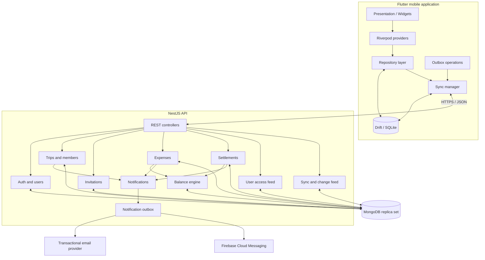
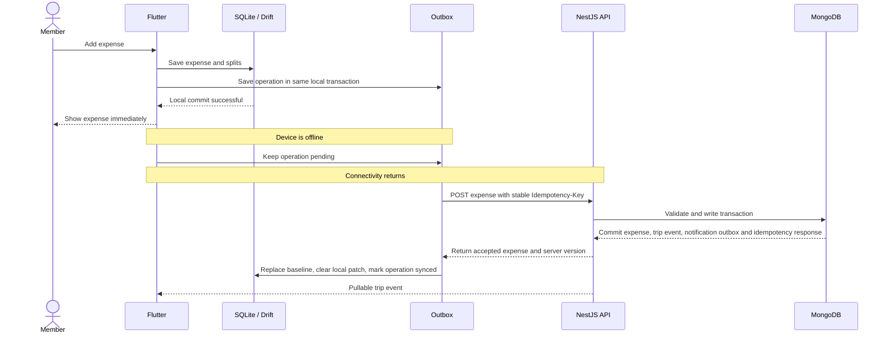

# Trip Expense Manager — Flutter Implementation Plan

**Document type:** Product and technical implementation specification  
**Status:** Implementation-ready MVP architecture (revision 2)  
**Revision:** 2 — closes synchronization, idempotency, offline-session, data-model and API-contract gaps  
**Primary client:** Flutter (Android and iOS)  
**Backend:** NestJS / Node.js  
**Database:** MongoDB (replica set; MongoDB Atlas recommended for production)  
**Local database:** Per-user SQLite with Drift, encrypted with SQLCipher in release builds  
**API style:** Versioned REST API  
**Initial currency:** INR, with one currency per trip  

**Implementation rule:** This document is the source of truth for the MVP. Any implementation choice that contradicts a rule here must be raised as a plan change before coding.  

---

## 1. Product overview

The Trip Expense Manager is an offline-first, collaborative expense application. A trip owner creates a trip, adds registered or guest participants, and records expenses paid by any participant. Each expense is split equally or by custom amounts. The application calculates each member's net balance and suggests transfers that settle the group with fewer payments.

The app must remain useful when a traveller has unreliable connectivity. Cached trips and expenses remain readable offline, and a member can add, edit or delete expenses involving already-cached participants. Local changes are saved immediately in SQLite and synchronized with the backend when connectivity returns.

### 1.1 Product goals

1. Let a user create and manage multiple trips.
2. Let a trip owner invite account holders by email.
3. Allow participants to be added as guests without requiring an account.
4. Let authorized account holders record expenses on behalf of any trip participant, including guests.
5. Support equal and custom expense splits.
6. Calculate accurate member balances and settlement suggestions.
7. Record and confirm settlements without counting settlements as new trip expenses.
8. Support reliable offline expense entry and eventual synchronization.
9. Preserve financial history when a member leaves or is removed.

### 1.2 Explicit MVP boundaries

Included:

- Email/password registration and login.
- Email verification and password reset.
- Trip creation, editing, listing and archiving.
- Registered and guest trip participants.
- Email-based trip invitations.
- Equal and custom expense splitting.
- Expense creation, editing, soft deletion and filtering.
- Member balances and settlement suggestions.
- Settlement recording, confirmation, rejection and cancellation.
- Local SQLite cache and offline expense outbox.
- Pull synchronization using a user-level access feed and a per-trip change feed.
- Conflict detection for concurrent expense edits.
- Basic dashboard and category/member summaries.
- Push notifications and transactional email for important events.

Deferred until after MVP:

- Receipt OCR and automatic receipt extraction.
- Automatic SMS, bank or UPI transaction detection.
- In-app payment processing or automatic UPI collection.
- Multi-currency expenses inside one trip and exchange-rate conversion.
- Itinerary, hotel, transport or ticket booking.
- Maps and live location sharing.
- Advanced recurring budgets and subscriptions.
- Social feed, comments and chat.
- Multi-payer expenses.
- Full offline membership administration and offline invitation acceptance.

---

## 2. Final product decisions

| Area | Decision |
|---|---|
| Mobile platform | Flutter for Android and iOS |
| State management | Riverpod |
| Navigation | GoRouter |
| Local database | Per-user SQLite through Drift, SQLCipher-encrypted in release |
| Networking | Dio |
| Backend | NestJS modular monolith |
| Database | MongoDB with Mongoose |
| IDs | UUID strings generated by the client for client-created entities |
| Authentication | Email/password, short-lived access tokens and rotating refresh tokens with reuse detection |
| Member types | Registered account member or guest member |
| Expense split types | Equal and custom |
| Expense payer | One payer per expense in MVP; payer can be a guest |
| Currency | One currency per trip; INR initially |
| Money representation | Integer minor units (paise for INR) |
| Offline write pattern | Local-first write plus transactional outbox and local overlay |
| Remote synchronization | Idempotent REST writes plus user-level and per-trip change feeds |
| Concurrent edit handling | Optimistic version checks and explicit conflict state |
| Backend deployment | One NestJS API service and managed MongoDB replica set |
| Trip currency | Immutable once any expense has been recorded, including a soft-deleted expense |
| Maximum amount | 1,000,000,000,000 minor units per expense or settlement |
| Maximum split participants | 100 per expense |
| Maximum trip members | 200 active members per trip |
| Local database isolation | One encrypted database per signed-in user |
| Offline session | Cached read/write for the previously authenticated user; new login requires network |
| Change-feed retention | 90 days or 100,000 events per trip, whichever is greater |
| Error contract | Stable error codes with `details` and `requestId` |

### 2.1 Registered members and guest members

There are two participant types:

**Registered member**

- Has a user account and can log in.
- Can access trips to which their account is linked.
- Can add expenses, view balances and synchronize their own device, subject to their trip role.
- Can receive invitations and notifications.

**Guest member**

- Is represented by a trip member record, not a user account.
- Can be added by name without registration or an email address.
- Can be selected as the payer or included in expense splits.
- Cannot log in, independently synchronize a device, or receive authenticated push notifications.
- Has expenses recorded by an authenticated trip member.

A guest's displayed name is not proof that the guest personally entered or confirmed a payment. The UI must distinguish **“Paid by Rahul (guest)”** from **“Recorded by Deep”** where appropriate.

### 2.2 Optional account conversion

A guest may later become a registered member. Do not create a second member automatically. Provide a controlled claim/link flow:

1. The guest registers and verifies their email address.
2. If the guest member record has that same normalized email, the account can request to claim the existing membership.
3. The server verifies the email and links `userId` to the existing member record, preserving its member ID and expense history.
4. If the guest member has no email, an owner/admin must send an invitation to the new account email and approve or initiate the link.
5. Prevent one user from being linked to two membership records in the same trip.

Guest conversion is included in the MVP. The schema and invitation flow must support it from the beginning.

### 2.3 Implementation limits and fixed defaults

These values are constants in the backend and client. They are not left to individual screens or endpoints.

| Setting | Value | Notes |
|---|---|---|
| `MAX_AMOUNT_MINOR` | `1_000_000_000_000` | Per expense and per settlement; all amounts must also be `Number.isSafeInteger` |
| `MAX_EXPENSE_PARTICIPANTS` | `100` | Split list length |
| `MAX_TRIP_MEMBERS` | `200` | Active members per trip |
| `MAX_PAGE_SIZE` | `100` | Expense, settlement and change-feed pages |
| `SYNC_BATCH_SIZE` | `100` | Events per pull |
| `ACCESS_TOKEN_TTL` | `15m` | Short-lived bearer token |
| `REFRESH_TOKEN_TTL_DAYS` | `30` | Rotating opaque token |
| `EMAIL_VERIFICATION_TTL_HOURS` | `24` | One-time token |
| `PASSWORD_RESET_TTL_MINUTES` | `30` | One-time token |
| `INVITATION_TTL_DAYS` | `7` | One-time token |
| `IDEMPOTENCY_RETENTION_DAYS` | `30` | Must exceed the maximum realistic offline retry window |
| `EVENT_RETENTION_DAYS` | `90` | Per-trip and per-user feed retention |
| `EVENT_RETENTION_COUNT` | `100_000` | Per-trip cap; cursor expiry triggers full resync |
| `OUTBOX_MAX_AUTOMATIC_ATTEMPTS` | `8` | After this, require user action or a new operation |
| `OUTBOX_BACKOFF` | Exponential from 2 s to 5 min, with jitter | Transient failures only |

Fixed product decisions:

- Date-only fields (`expenseDate`, `startDate`, `endDate`, `paymentDate`) are calendar dates (`YYYY-MM-DD`) in the trip's local timezone and are never converted to UTC timestamps.
- Timestamps (`createdAt`, `updatedAt`, `confirmedAt`) are stored and transferred in UTC ISO-8601.
- Expense categories are a fixed enum: `food`, `stay`, `transport`, `activities`, `shopping`, `other`.
- The owner can edit or delete any expense. An admin or member can edit or delete only expenses they created. There is no per-trip toggle for this rule.
- Archived trips are read-only for expenses and settlements. Unarchive before writing.
- The owner cannot leave or be removed until ownership is transferred.
- Account deletion anonymizes personal data but retains financial records with a neutral display name such as `Deleted user`.
- A pending settlement is a reservation for settlement suggestions. It never changes confirmed balances.

---

## 3. Architecture overview

Use a **modular monolith** for the NestJS backend. Authentication, trips, members, invitations, expenses, balances, settlements and synchronization are separate modules in one deployable backend. Microservices are not required for this product's initial scale.



### 3.1 Source-of-truth responsibilities

- **MongoDB:** authoritative shared data and financial records.
- **SQLite:** per-user, encrypted device-local cache, locally pending changes and outbox operations.
- **NestJS:** authorization, validation, financial calculations, conflict detection and synchronization rules.
- **Flutter:** presentation and local interaction; it must not be trusted as the final authority for money or permissions.

### 3.2 Backend modules

```text
src/
├── main.ts
├── app.module.ts
├── common/
│   ├── decorators/
│   ├── guards/
│   ├── filters/
│   ├── interceptors/
│   ├── pipes/
│   └── utils/
├── config/
├── database/
│   ├── database.module.ts
│   ├── mongoose.module.ts
│   ├── models/
│   └── indexes/
├── auth/
├── users/
├── trips/
├── members/
├── invitations/
├── expenses/
├── balances/
├── settlements/
├── sync/
├── notifications/
├── outbox/
├── audit/
└── health/
```

Each module should own its DTOs, controller, service, database schema/model and tests. Shared financial rules should live in a dedicated domain/service layer rather than being duplicated in controllers.

The `outbox` module dispatches transactional email and push records after commit. The `audit` module exposes the append-only `tripEvents`/`userEvents` history for support and conflict review; it does not expose invitation tokens or credentials.

---

## 4. MongoDB data model

MongoDB is suitable for this application when the data model is designed around aggregate documents. The main design choice is to **embed expense splits inside the expense document**. An expense and its allocations are normally read and changed together, and embedding makes that operation atomic at the document level.

Keep trips, members, invitations, expenses, settlements and events as separate collections. Do not embed every trip expense or every member inside the trip document: those arrays can grow without bound and create document contention and document-size limits.

### 4.1 Collections

| Collection | Purpose |
|---|---|
| `users` | Registered accounts and profile information |
| `trips` | Trip metadata and synchronization version |
| `tripMembers` | Registered and guest participants in each trip |
| `tripInvitations` | Invitation tokens and invitation lifecycle |
| `expenses` | Expense details with embedded split allocations |
| `settlements` | Payment/settlement records |
| `tripEvents` | Append-only synchronization events |
| `refreshTokens` | Hashed refresh-token sessions with rotation families |
| `idempotencyRecords` | Deduplication of retried write requests |
| `userTokens` | Hashed email-verification and password-reset tokens |
| `userEvents` | Per-user change feed for trip access and invitations |
| `deviceTokens` | FCM device registrations per user and device |
| `notificationOutbox` | Durable email/push dispatch records |

`userEvents` is the user-scoped companion to `tripEvents`. It tells a device that it gained or lost access to a trip, or that an invitation changed, without forcing the client to poll every trip. `userTokens` keeps verification and reset secrets out of the `users` document and out of logs.

Use UUID strings for document `_id` values. This allows Flutter to create stable IDs while offline and send those same IDs to the backend later. The backend must still validate every ID and relationship; a client-generated UUID is an identifier, not an authorization mechanism.

### 4.2 `users` document

```json
{
  "_id": "user-uuid",
  "name": "Deep Mujpara",
  "email": "deep@example.com",
  "emailNormalized": "deep@example.com",
  "passwordHash": "<password-hash>",
  "passwordChangedAt": "2026-11-04T12:00:00.000Z",
  "emailVerifiedAt": "2026-11-04T12:00:00.000Z",
  "notificationPreferences": {
    "push": true,
    "email": true,
    "invitations": true,
    "expenses": true,
    "settlements": true
  },
  "syncVersion": 4,
  "deletedAt": null,
  "createdAt": "2026-11-04T11:00:00.000Z",
  "updatedAt": "2026-11-04T12:00:00.000Z"
}
```

Indexes:

- Unique index on `emailNormalized`.
- `{ syncVersion: 1 }` is not required; it is read with the user document.

Rules:

- Normalize email consistently before lookup or insertion.
- Never store plain-text passwords or invitation tokens.
- Use a suitable password hashing algorithm such as Argon2id or bcrypt with production-appropriate parameters.
- `passwordChangedAt` invalidates outstanding access and refresh tokens when the password or account status changes.
- `notificationPreferences` stores per-channel and per-category opt-ins. The notification dispatcher checks them before sending; security-critical email such as password reset ignores marketing-style preferences but still respects account status.
- `syncVersion` increments whenever a `userEvents` record is written for this user.
- Account deletion sets `deletedAt`, revokes every refresh token and device token, anonymizes `name` and `email`, and replaces `emailNormalized` with a unique non-routable value so the original email can be registered again. Linked member records clear `emailNormalized` and display the neutral name; pending invitations for the old email are revoked. Financial records keep the user ID. Deletion requires transferring ownership of any owned trip that has another active member; a trip where the deleting user is the sole active member becomes an inaccessible retained record.

### 4.3 `trips` document

```json
{
  "_id": "trip-uuid",
  "name": "Goa Trip 2026",
  "destination": "Goa, India",
  "description": "Year-end trip",
  "currency": "INR",
  "currencyExponent": 2,
  "startDate": "2026-12-15",
  "endDate": "2026-12-20",
  "createdByUserId": "user-uuid",
  "ownerUserId": "user-uuid",
  "syncVersion": 1,
  "archivedAt": null,
  "createdAt": "2026-11-04T12:00:00.000Z",
  "updatedAt": "2026-11-04T12:00:00.000Z"
}
```

Indexes:

- `{ ownerUserId: 1, archivedAt: 1, updatedAt: -1 }`
- `{ createdByUserId: 1 }`

Rules:

- `currency` and `currencyExponent` are immutable once any expense has been recorded, including a soft-deleted expense. Changing currency after money has been recorded would corrupt historical records and balances; the API must reject it.
- Archived trips are read-only for expenses and settlements. Metadata edits are allowed only while the trip is active.
- `syncVersion` is a per-trip monotonic sequence starting at `1`. It is incremented in the same transaction as every `tripEvents` insert.
- The sequence must remain within JavaScript's safe integer range. At the cap, reject new writes and require an operational reset rather than silently wrapping.

### 4.4 `tripMembers` document

```json
{
  "_id": "member-uuid",
  "tripId": "trip-uuid",
  "userId": "user-uuid-or-null",
  "displayName": "Rahul",
  "emailNormalized": "rahul@example.com",
  "memberKind": "guest",
  "role": "member",
  "status": "active",
  "createdByUserId": "owner-user-uuid",
  "joinedAt": null,
  "createdAt": "2026-11-04T12:00:00.000Z",
  "updatedAt": "2026-11-04T12:00:00.000Z"
}
```

Allowed values:

- `memberKind`: `account`, `guest`
- `role`: `owner`, `admin`, `member`
- `status`: `invited`, `active`, `left`, `removed`

Rules:

- `guest` records must have `userId: null`.
- An active `account` member must have a valid `userId`.
- An invitation can create an `account` member with `status: invited` and `userId: null` until it is accepted.
- A trip owner must be an account member.
- A removed member is retained for historical financial records.
- Only `status: active` members are eligible as payer or split participant for new expenses. `invited`, `left` and `removed` members are never eligible for new expenses, but historical expenses and balances still reference them.
- Exactly one `owner` membership must exist per trip. The owner cannot be removed or leave until ownership is transferred to another active account member.
- A user can have at most one membership record per trip. Reactivate the existing historical record instead of creating a duplicate.
- A trip may have at most `MAX_TRIP_MEMBERS` (200) non-removed memberships. Reject further additions.
- `emailNormalized` may be null for guests. Multiple guests without email must be allowed in the same trip.
- A guest's `displayName` is a label, not proof of identity. The expense and settlement records must retain the difference between `paidByMemberId` and the acting user.
- For an account member linked to a user, `emailNormalized` mirrors the verified account email. When the account email changes, update the linked member records and emit `member.updated` events in the same transaction.
- `emailNormalized` is privileged: return it only to the owner, admins and the account member themselves. Never include it in trip change-feed payloads or expose it to ordinary members.

Indexes:

- Unique partial index `{ tripId: 1, userId: 1 }` where `userId` is a string.
- Unique partial index `{ tripId: 1, emailNormalized: 1 }` where `emailNormalized` is a string. Do not use a plain unique index here: MongoDB treats null as an indexed value, which would allow only one email-less guest per trip.
- `{ tripId: 1, status: 1 }`
- `{ userId: 1, status: 1 }`
- `{ tripId: 1, memberKind: 1, status: 1 }`

MongoDB partial indexes and Mongoose index declarations should be checked against the exact MongoDB server version used in production. If the intended unique partial index is not supported by the deployed version, perform the duplicate check transactionally and maintain a separate normalized membership key.

### 4.5 `tripInvitations` document

```json
{
  "_id": "invitation-uuid",
  "tripId": "trip-uuid",
  "memberId": "member-uuid",
  "invitedByUserId": "user-uuid",
  "emailNormalized": "rahul@example.com",
  "tokenHash": "<sha256-or-strong-hash-of-random-token>",
  "status": "pending",
  "expiresAt": "2026-11-11T12:00:00.000Z",
  "acceptedAt": null,
  "respondedAt": null,
  "revokedAt": null,
  "createdAt": "2026-11-04T12:00:00.000Z",
  "updatedAt": "2026-11-04T12:00:00.000Z"
}
```

Allowed states: `pending`, `accepted`, `declined`, `revoked`, `expired`.

Rules:

- Accept by token (deep link) or by invitation ID for an authenticated account whose verified normalized email matches the invitation.
- Only one pending invitation may exist per trip and normalized email. Inviting the same email again resends and rotates the existing invitation instead of creating a duplicate.
- If the email already belongs to an active member of the trip, reject the invitation with a conflict instead of creating a second membership.
- If a member record with the same `emailNormalized` already exists in the trip, including a guest, left or removed record, the invitation must attach to that existing member and upgrade or reactivate it on acceptance instead of creating a second membership record.
- Resending rotates the token, invalidates the previous token, and keeps the same invitation/member identity.
- Revoking, declining or expiring an invitation must also cancel the provisional `invited` membership so the trip never keeps a phantom active member.
- The token is single-use. Expiry is checked on acceptance; a TTL index is cleanup only.
- If the invitee does not have an account, the deep-link token must survive registration and email verification. The client stores it securely until acceptance.
- Acceptance writes the invitation update, membership link, `userEvent`, `tripEvent` and notification outbox record in one transaction.

Indexes:

- Unique `{ tokenHash: 1 }`.
- Unique partial `{ tripId: 1, emailNormalized: 1 }` where `status` is `pending`.
- `{ emailNormalized: 1, status: 1 }`.
- `{ tripId: 1, status: 1 }`.
- `{ memberId: 1 }`.

Invitation tokens must be generated using a cryptographically secure random generator. Store only a hash of the token. Expiry must be checked when accepting; do not depend solely on a TTL index to enforce expiry. Retain invitation history for audit/support purposes.

### 4.6 `expenses` document with embedded splits

```json
{
  "_id": "expense-uuid",
  "tripId": "trip-uuid",
  "title": "Dinner",
  "amountMinor": 250000,
  "currency": "INR",
  "paidByMemberId": "member-deep-uuid",
  "createdByUserId": "user-deep-uuid",
  "updatedByUserId": "user-deep-uuid",
  "deletedByUserId": null,
  "splitType": "equal",
  "splits": [
    { "memberId": "member-deep-uuid", "amountMinor": 62500 },
    { "memberId": "member-rahul-uuid", "amountMinor": 62500 },
    { "memberId": "member-jay-uuid", "amountMinor": 62500 },
    { "memberId": "member-amit-uuid", "amountMinor": 62500 }
  ],
  "category": "food",
  "expenseDate": "2026-12-15",
  "description": "Dinner for the group",
  "status": "active",
  "version": 1,
  "clientCreatedAt": "2026-12-15T14:00:00.000Z",
  "createdAt": "2026-12-15T14:00:00.000Z",
  "updatedAt": "2026-12-15T14:00:00.000Z",
  "deletedAt": null
}
```

Allowed values:

- `splitType`: `equal`, `custom`
- `status`: `active`, `deleted`

Indexes:

- `{ tripId: 1, status: 1, expenseDate: -1, _id: -1 }`
- `{ tripId: 1, paidByMemberId: 1, expenseDate: -1 }`
- `{ tripId: 1, "splits.memberId": 1 }`
- `{ tripId: 1, createdByUserId: 1, createdAt: -1 }`

Validation rules:

1. `amountMinor` is a positive safe integer no greater than `MAX_AMOUNT_MINOR`.
2. Every split amount is a non-negative safe integer.
3. The sum of all split amounts equals `amountMinor` exactly.
4. Every split member belongs to the same trip. Any member newly added by this write must be `active`; existing split participants may remain after they leave, so editing an old expense does not erase history.
5. `paidByMemberId` belongs to the same trip. A newly selected payer must be `active`; an unchanged historical payer may remain after leaving.
6. The authenticated actor is authorized to create/edit this expense under §12.1.
7. Only active expenses are included in spending and balance calculations.
8. An expense update increments `version` using a conditional write on the expected version.
9. Deletion is a soft delete, increments `version`, records `deletedByUserId` and `deletedAt`, and retains the split rows and audit event.
10. `currency` must equal the trip's currency.
11. The split list is not empty and contains no more than `MAX_EXPENSE_PARTICIPANTS` entries.
12. The payer does not have to appear in the split list. This supports “A paid for B and C”.
13. `expenseDate` is a calendar date in the trip timezone, not a UTC instant.
14. A client-generated expense ID is accepted, but the server validates it is a UUID, is unused, and is only ever associated with the submitting actor's trip. A duplicate ID returns a conflict, not an overwrite.
15. Equal-split allocation is computed by the backend using the deterministic rule in §5.3. The client preview is never authoritative.

The payer may be a guest, but `createdByUserId` must identify the authenticated user who recorded the expense. This separates the claimed payer from the person who entered the data.

### 4.7 `settlements` document

```json
{
  "_id": "settlement-uuid",
  "tripId": "trip-uuid",
  "paidByMemberId": "member-rahul-uuid",
  "paidToMemberId": "member-deep-uuid",
  "amountMinor": 100000,
  "paymentDate": "2026-12-20",
  "status": "pending",
  "recordedByUserId": "user-rahul-uuid",
  "confirmedByUserId": null,
  "statusChangedByUserId": null,
  "statusChangedAt": null,
  "rejectionReason": null,
  "note": "UPI payment",
  "version": 1,
  "createdAt": "2026-12-20T12:00:00.000Z",
  "confirmedAt": null
}
```

Allowed states: `pending`, `confirmed`, `rejected`, `cancelled`.

State transitions:

| From | To | Allowed actor |
|---|---|---|
| `pending` | `confirmed` | The receiver. If the receiver is a guest, an owner or admin may confirm on the guest's behalf |
| `pending` | `rejected` | The receiver, or an owner/admin acting for a guest receiver |
| `pending` | `cancelled` | The sender or the user who recorded the settlement |
| `rejected` | `cancelled` | The recorder, to close the record |
| `confirmed` | — | Terminal; correct it with a new opposing settlement, never by editing a confirmed amount |

Rules:

- Only confirmed settlements affect balances. Pending settlements are reservations for settlement suggestions only.
- A registered receiver confirms their own settlement. An owner or admin cannot confirm a settlement addressed to another registered account member.
- Every state transition uses `If-Match` with the current version, increments `version` and is idempotent via `Idempotency-Key`.
- Both participants must be active members of the same trip at the time the settlement is recorded. Historical settlements remain valid after either participant leaves.
- A settlement amount is a positive safe integer no greater than `MAX_AMOUNT_MINOR`.
- The recorder may differ from the sender; guest payments are recorded by an authorized account holder.
- Each transition writes a `tripEvents` record with the full settlement snapshot.

Indexes:

- `{ tripId: 1, status: 1, paymentDate: -1 }`
- `{ tripId: 1, paidByMemberId: 1 }`
- `{ tripId: 1, paidToMemberId: 1 }`

Only confirmed settlements affect balances. The sender is `paidByMemberId`, and the receiver is `paidToMemberId`.

The MVP records payments that happened outside the app; it does not move money or verify UPI transactions.

### 4.8 `tripEvents` change-feed document

```json
{
  "_id": "event-uuid",
  "tripId": "trip-uuid",
  "sequence": 27,
  "eventType": "expense.created",
  "entityType": "expense",
  "entityId": "expense-uuid",
  "actorUserId": "user-uuid",
  "payload": {
    "id": "expense-uuid",
    "tripId": "trip-uuid",
    "title": "Dinner",
    "amountMinor": 250000,
    "currency": "INR",
    "paidByMemberId": "member-deep-uuid",
    "createdByUserId": "user-deep-uuid",
    "splitType": "equal",
    "splits": [
      { "memberId": "member-deep-uuid", "amountMinor": 62500 },
      { "memberId": "member-rahul-uuid", "amountMinor": 62500 },
      { "memberId": "member-jay-uuid", "amountMinor": 62500 },
      { "memberId": "member-amit-uuid", "amountMinor": 62500 }
    ],
    "category": "food",
    "expenseDate": "2026-12-15",
    "status": "active",
    "version": 1
  },
  "createdAt": "2026-12-15T14:00:00.000Z"
}
```

Indexes:

- Unique `{ tripId: 1, sequence: 1 }`.
- `{ tripId: 1, createdAt: 1 }`.

Event catalog:

| `eventType` | `entityType` | Payload |
|---|---|---|
| `trip.created` | `trip` | Full trip snapshot |
| `trip.updated` | `trip` | Full trip snapshot |
| `member.added` | `member` | Full member snapshot |
| `member.updated` | `member` | Full member snapshot |
| `member.removed` | `member` | Full member snapshot |
| `expense.created` | `expense` | Full expense snapshot with splits |
| `expense.updated` | `expense` | Full expense snapshot with splits |
| `expense.deleted` | `expense` | Full soft-deleted expense snapshot with splits |
| `settlement.created` | `settlement` | Full settlement snapshot |
| `settlement.updated` | `settlement` | Full settlement snapshot |

Rules:

- Each event payload is a **full bounded snapshot of the entity at that version**, not a partial patch. Splits are capped at 100, so the payload stays bounded. Privileged fields that are not visible to every trip member, such as `emailNormalized`, are omitted consistently. This avoids “fetch the latest entity” races where a newer version is applied out of order.
- `sequence` starts at `1` and is contiguous per trip. The trip's `syncVersion` and the event sequence are allocated in the same transaction.
- Invitation lifecycle changes are **not** written to `tripEvents`, because they would leak invitee email addresses to every trip member. They are written to `userEvents` and, where appropriate, `member.updated`.
- Member event payloads omit `emailNormalized`. Member email addresses are privileged data and are never written to `tripEvents`.
- Do not put password hashes, refresh tokens, invitation secrets, verification tokens or other credentials in event payloads.
- Retain events for at least 90 days or 100,000 events per trip, whichever is greater. If a device presents a cursor older than the retained window, return `410 CURSOR_EXPIRED` and require a snapshot resync.
- Event consumers must treat duplicate delivery as a no-op and must reject regressions where the incoming `version` is older than the locally applied version.

### 4.9 Authentication, idempotency and delivery collections

#### 4.9.1 `refreshTokens`

```json
{
  "_id": "refresh-token-uuid",
  "userId": "user-uuid",
  "familyId": "session-family-uuid",
  "tokenHash": "<sha256-of-random-token>",
  "deviceId": "device-uuid",
  "userAgent": "TripApp/1.0 (Android 15)",
  "issuedAt": "2026-11-04T12:00:00.000Z",
  "lastUsedAt": "2026-11-04T12:00:00.000Z",
  "expiresAt": "2026-12-04T12:00:00.000Z",
  "revokedAt": null,
  "revokedReason": null,
  "replacedByTokenHash": null,
  "createdAt": "2026-11-04T12:00:00.000Z"
}
```

Indexes:

- Unique `{ tokenHash: 1 }`.
- `{ userId: 1, revokedAt: 1 }`.
- `{ familyId: 1 }`.
- TTL cleanup on `expiresAt`, used only for storage cleanup.

Rules:

- Store only a hash of the raw refresh token.
- Every refresh rotates the token: the old record is revoked, the new token is issued into the same `familyId`, and `replacedByTokenHash` links the chain.
- **Refresh-token reuse detection:** if a token that is already revoked is presented, revoke the entire `familyId` and force re-authentication. This detects stolen-token replay.
- Logout revokes the presented token. Logout-all revokes every active family for the user.
- A password change, account deletion or administrative lock revokes every active family.
- The access token carries `sub`, `familyId`, `iat` and the user's `passwordChangedAt` epoch. Reject a token whose `passwordChangedAt` epoch is older than the current user record.

#### 4.9.2 `idempotencyRecords`

```json
{
  "_id": "idempotency-uuid",
  "actorUserId": "user-uuid",
  "idempotencyKey": "outbox-operation-uuid",
  "requestHash": "<sha256-of-canonical-request>",
  "responseStatus": 201,
  "responseBody": { "success": true, "data": {} },
  "createdAt": "2026-11-04T12:00:00.000Z",
  "expiresAt": "2026-12-04T12:00:00.000Z"
}
```

Indexes:

- Unique `{ actorUserId: 1, idempotencyKey: 1 }`.
- TTL cleanup on `expiresAt`.

Rules:

- The request hash is computed over a canonical form of method, path, query and body (sorted keys, no whitespace, no client headers that do not affect the result).
- Reusing a key with the same hash returns the stored response verbatim. Reusing it with a different hash returns `409 IDEMPOTENCY_KEY_REUSED`.
- Only terminal outcomes are stored: successful `2xx` responses and terminal `4xx` responses. Never store transient `5xx` or network failures.
- The lookup-then-insert race is handled by the unique index. If insertion fails with duplicate key, re-read the existing record, compare the hash and return the stored result. Do not create a second entity.
- Retain records for `IDEMPOTENCY_RETENTION_DAYS` (30 days). This must exceed the maximum realistic offline retry window; a shorter TTL can create duplicate expenses after a long offline period.

#### 4.9.3 `userTokens`

```json
{
  "_id": "user-token-uuid",
  "userId": "user-uuid",
  "type": "email_verification",
  "tokenHash": "<sha256-of-random-token>",
  "expiresAt": "2026-11-05T12:00:00.000Z",
  "usedAt": null,
  "revokedAt": null,
  "createdAt": "2026-11-04T12:00:00.000Z"
}
```

Allowed `type` values: `email_verification`, `password_reset`.

Indexes:

- Unique `{ tokenHash: 1 }`.
- `{ userId: 1, type: 1, usedAt: 1, revokedAt: 1 }`.

Rules:

- Issue a new token only after marking the previous unused token of the same type as `revokedAt`.
- Tokens are single-use and hashed at rest. Both `usedAt` and `revokedAt` block reuse.
- Password reset also revokes all refresh-token families and increments `users.passwordChangedAt`.
- Verification tokens are checked for expiry and `usedAt` on use; TTL indexes are cleanup only.

#### 4.9.4 `userEvents`

```json
{
  "_id": "user-event-uuid",
  "userId": "user-uuid",
  "sequence": 7,
  "eventType": "trip.access.granted",
  "tripId": "trip-uuid",
  "payload": {
    "tripId": "trip-uuid",
    "memberId": "member-uuid",
    "role": "member"
  },
  "createdAt": "2026-11-04T12:00:00.000Z"
}
```

Indexes:

- Unique `{ userId: 1, sequence: 1 }`.
- `{ userId: 1, createdAt: 1 }`.

Event types: `trip.access.granted`, `trip.access.revoked`, `trip.membership.changed`, `invitation.created`, `invitation.updated`, `account.deleted`.

Rules:

- `users.syncVersion` is incremented in the same transaction as the `userEvents` insert and supplies `sequence`.
- These events never contain invitation tokens, verification tokens or another member's email address.
- Invitation events carry the invitation ID, trip ID, role and status only; the client fetches invitation details through `/invitations` if it needs more.
- A `trip.access.granted` event tells the client to add the trip to its local cache and pull that trip's snapshot and change feed.
- A revoked-access event must be delivered before the device is allowed to push any further outbox operations for that trip.
- Retain for at least the same window as `tripEvents`; cursor expiry returns `410 CURSOR_EXPIRED`.

#### 4.9.5 `deviceTokens`

```json
{
  "_id": "device-token-uuid",
  "userId": "user-uuid",
  "deviceId": "device-uuid",
  "platform": "android",
  "fcmToken": "<token>",
  "createdAt": "2026-11-04T12:00:00.000Z",
  "lastSeenAt": "2026-11-04T12:00:00.000Z",
  "revokedAt": null
}
```

Indexes:

- Unique `{ deviceId: 1 }`.
- `{ userId: 1, revokedAt: 1 }`.
- `{ fcmToken: 1 }`.

Rules:

- A device is owned by one user at a time. Registering a device for another user revokes the previous binding.
- Logout and account deletion revoke the binding.
- FCM token rotation updates the same `deviceId` rather than creating duplicates.
- Remove invalid tokens reported by FCM.

#### 4.9.6 `notificationOutbox`

```json
{
  "_id": "notification-uuid",
  "channel": "push",
  "recipientUserId": "user-uuid",
  "recipientDeviceIds": ["device-uuid"],
  "template": "expense.created",
  "payload": { "tripId": "trip-uuid", "expenseId": "expense-uuid" },
  "dedupeKey": "expense.created:expense-uuid:user-uuid",
  "status": "pending",
  "attemptCount": 0,
  "nextAttemptAt": "2026-11-04T12:00:10.000Z",
  "sentAt": null,
  "lastError": null,
  "createdAt": "2026-11-04T12:00:00.000Z"
}
```

Indexes:

- Unique `{ dedupeKey: 1 }`.
- `{ status: 1, nextAttemptAt: 1 }`.

Rules:

- Email and push records are written inside the same transaction as the business change, then dispatched after commit by the `outbox` module.
- Delivery is at-least-once; consumers and templates must tolerate duplicates.
- After `OUTBOX_MAX_AUTOMATIC_ATTEMPTS`, mark `status: dead` and alert; do not retry forever.
- Never include tokens, full financial histories or unnecessary personal data in a notification payload.

### 4.10 MongoDB transaction requirement

A single expense document write is atomic, including its embedded splits. However, a complete trip mutation also needs to:

1. Validate the DTO, actor, trip, membership and permissions.
2. Look up the idempotency key; return the stored response for the same request hash, or `409 IDEMPOTENCY_KEY_REUSED` for a different hash.
3. For an update, delete or settlement transition, perform a conditional write on the expected `version`/state.
4. Insert or update the entity document.
5. Atomically increment the trip's `syncVersion` and obtain the new sequence.
6. Insert the `tripEvents` record with the full client-visible entity snapshot and that sequence.
7. For membership or access changes, increment the affected user's `syncVersion` and insert the corresponding `userEvents` record.
8. Insert the `notificationOutbox` records.
9. Insert the idempotency record with the terminal response.
10. Commit the transaction.

These are multiple documents. Use a MongoDB transaction so they succeed or fail together. **Multi-document transactions require a replica set or sharded cluster.** Use MongoDB Atlas or configure a replica set for local development and production. Do not build the production synchronization design around a standalone MongoDB server.

Use Mongoose sessions and `withTransaction`, with retry handling for transient transaction errors and write conflicts. Use `readConcern: snapshot` and `writeConcern: majority` for financial mutations. Do not send email or push notifications inside a transaction callback: write the notification outbox record transactionally, then dispatch it after commit.

If the idempotency insert loses a race to a concurrent retry, catch the duplicate-key error, re-read the record, compare the request hash and return the stored response. Do not surface a raw MongoDB duplicate-key error to the client.

---

## 5. Financial rules and calculation engine

Financial rules must be implemented on the backend and covered by automated tests. Flutter may show provisional local calculations, but the server response is authoritative.

### 5.1 Money representation

Store monetary amounts as integer minor units:

- INR ₹1.00 = `100` paise.
- INR ₹2,500.00 = `250000` paise.

Do not use binary floating-point values for financial calculations. In the Node.js implementation, validate every amount with `Number.isSafeInteger(value)` and enforce `0 < value <= MAX_AMOUNT_MINOR` (`1_000_000_000_000`). Also validate that intermediate sums, such as the sum of splits or a trip total, remain safe integers. If the application ever needs amounts beyond JavaScript's safe integer range, use BSON `Long` consistently and serialize it as a decimal string in JSON. Do not mix integer, floating-point and string representations casually.

A trip stores its currency code and currency exponent. All expenses in the trip use that currency in the MVP. Do not allow an expense to select another currency independently. Validate the currency and exponent against an ISO-4217 allowlist; INR is the only enabled currency for MVP. The amount cap applies to each expense and each settlement, not to the safe-integer sum of a trip's history, which must still be checked at calculation time.

### 5.2 Balance formula

For each member:

```text
net balance = total expenses paid
            - total expense shares
            + confirmed settlements paid
            - confirmed settlements received
```

Interpretation:

- Positive balance: the member should receive money.
- Negative balance: the member owes money.
- Zero balance: the member is settled.

Pending, rejected and cancelled settlements do not affect balances. Deleted expenses do not affect balances.

The sum of balances for a trip must equal zero, provided all active expense amounts are fully allocated and every confirmed settlement has both a payer and receiver.

### 5.3 Equal split and paise remainder

For amount `A` and `N` participants:

```text
base = floor(A / N)
remainder = A % N
```

Allocate `base + 1` to the first `remainder` participants in a deterministic order, and `base` to the others. Use a stable ordering (for example, sorted member UUIDs) so a retry produces identical allocations. The exact total must always equal `A`.

Example: ₹100.00 = 10,000 paise shared by three members:

- Member A: 3,334 paise (₹33.34)
- Member B: 3,333 paise (₹33.33)
- Member C: 3,333 paise (₹33.33)

### 5.4 Custom split

The client submits the exact minor-unit share for each participant. The backend validates:

- No negative shares.
- No duplicate member IDs.
- Every member belongs to the same trip.
- Sum of shares exactly equals expense amount.
- Split list is not empty.

### 5.5 Settlement suggestion algorithm

1. Calculate all member net balances from active expenses and **confirmed** settlements.
2. Apply pending settlements as reservations so the app does not suggest a payment that is already in flight. For each pending settlement, reduce the sender's outstanding debt and the receiver's outstanding receivable by `min(amount, outstanding)` for that pair, without changing confirmed balances.
3. Put members with positive remaining amounts in a creditor list.
4. Put members with negative remaining amounts in a debtor list, using the absolute value.
5. Sort both lists by descending amount, with member ID as a deterministic tie-breaker.
6. Match the largest debtor and creditor for the smaller of their outstanding balances.
7. Reduce both balances and continue until all are zero.
8. Return both the suggested transfers and the pending reservations that were applied, so the UI can explain why a suggestion differs from the raw balance.

This greedy algorithm creates at most `n - 1` transfers for a balanced group, although it does not guarantee a globally minimal number of transfers under every possible tie arrangement.

### 5.6 Balance calculation implementation approach

For an MVP-sized trip, use two MongoDB aggregation queries or fetch the trip's active expenses and confirmed settlements and compute an integer-based balance map in a domain service. Add pagination only to expense-history APIs; balance aggregation must consider all relevant records.

Use primary read preference for financial reads. When the implementation makes more than one query, wrap them in a snapshot read concern or a transaction so expenses and settlements come from the same logical point in time. Removed and left members remain in the balance map so historical debts are not erased.

For larger trips, implement indexed aggregation pipelines:

- Expense payer contribution: `+ amountMinor` for `paidByMemberId`.
- Expense split contribution: `- split.amountMinor` for each split member.
- Settlement sender contribution: `+ amountMinor` for `paidByMemberId`.
- Settlement receiver contribution: `- amountMinor` for `paidToMemberId`.

Merge these contributions by member ID. Assert that the sum is zero before returning the balance response. If it is not zero, log a high-severity integrity error and do not silently display a seemingly valid result.

---

## 6. API specification

Base URL:

```text
https://api.example.com/v1
```

Use JSON request/response bodies, HTTPS only and a consistent error structure.

Success:

```json
{
  "success": true,
  "data": {},
  "message": "Operation completed successfully",
  "requestId": "req-uuid"
}
```

Error:

```json
{
  "success": false,
  "error": {
    "code": "EXPENSE_VERSION_CONFLICT",
    "message": "The expense was changed by another device",
    "details": {
      "currentVersion": 5,
      "refetchUrl": "/v1/trips/trip-uuid/expenses/expense-uuid"
    }
  },
  "requestId": "req-uuid"
}
```

Rules:

- `requestId` is returned on every response and written to logs.
- `error.details` is optional, machine-readable and never contains secrets.
- Use HTTP `400` for validation, `401` for authentication, `403` for authorization, `404` for missing resources, `409` for version/idempotency/state conflicts, `410` for an expired sync cursor, `429` for rate limits and `5xx` for transient server failures.
- A `429` response includes `Retry-After`.
- A stale `If-Match` returns `409` with `details.currentVersion` and `details.refetchUrl`.
- A cursor older than the retained event window returns `410 CURSOR_EXPIRED` with `details.snapshotUrl`.
- A request with a required `If-Match` missing returns `428 PRECONDITION_REQUIRED`.
- `Idempotency-Key` is required for trip creation, membership changes, invitations, expenses and settlements. Authentication/session endpoints do not take an `Idempotency-Key`; they rely on token rotation, rate limits and unique constraints.
- A terminal `2xx` or `4xx` write response is reusable for the same key and request hash. Never reuse one key for two different payloads.
- Unless an example explicitly shows the envelope, examples below show only the `data` payload. Every HTTP response is wrapped in the standard success or error envelope.

Stable error codes (non-exhaustive):

| Code | Typical status | Retryable |
|---|---|---|
| `VALIDATION_ERROR` | 400 | No |
| `AUTH_INVALID_CREDENTIALS` | 401 | No |
| `AUTH_EMAIL_UNVERIFIED` | 403 | No |
| `AUTH_TOKEN_EXPIRED` | 401 | Refresh then retry once |
| `AUTH_REFRESH_REUSED` | 401 | No; force login |
| `FORBIDDEN` | 403 | No |
| `TRIP_NOT_FOUND` | 404 | No |
| `MEMBER_NOT_ELIGIBLE` | 409 | No |
| `TRIP_ARCHIVED` | 409 | No |
| `CURRENCY_IMMUTABLE` | 409 | No |
| `EXPENSE_SPLIT_MISMATCH` | 400 | No |
| `EXPENSE_VERSION_CONFLICT` | 409 | Reconcile |
| `SETTLEMENT_INVALID_TRANSITION` | 409 | No |
| `IDEMPOTENCY_KEY_REUSED` | 409 | No |
| `EMAIL_IN_USE` | 409 | No |
| `ENTITY_ID_CONFLICT` | 409 | No |
| `PRECONDITION_REQUIRED` | 428 | Fix request |
| `CURSOR_EXPIRED` | 410 | Full resync |
| `RATE_LIMITED` | 429 | Yes, after `Retry-After` |
| `INTERNAL_ERROR` | 500 | Yes, with backoff |

### 6.1 Authentication and profile

| Method | Endpoint | Purpose |
|---|---|---|
| POST | `/auth/register` | Create account |
| POST | `/auth/login` | Login |
| POST | `/auth/refresh` | Rotate refresh token and issue access token |
| POST | `/auth/logout` | Revoke current refresh session |
| POST | `/auth/verify-email` | Verify email using a one-time token/code |
| POST | `/auth/resend-verification` | Issue a new verification token |
| POST | `/auth/forgot-password` | Request password reset |
| POST | `/auth/reset-password` | Complete password reset |
| POST | `/auth/change-password` | Change password and revoke other sessions |
| POST | `/auth/logout-all` | Revoke all refresh-token families |
| GET | `/users/me` | Get current profile |
| PATCH | `/users/me` | Update profile |
| GET | `/users/me/sessions` | List active devices/sessions |
| DELETE | `/users/me/sessions/:sessionId` | Revoke one session |
| DELETE | `/users/me` | Delete account and anonymize personal data |

Authentication rules:

- An account may log in before email verification, but trip participation, invitation acceptance and invitation sending require a verified email. Protected endpoints that require verification return `403 AUTH_EMAIL_UNVERIFIED`.
- `forgot-password` always returns the same success response to prevent account enumeration.
- Changing email requires the current password, must respect the unique normalized email constraint, sets `emailVerifiedAt` to null and starts a new verification flow. The old email cannot be used to accept invitations after the change. Linked account-member records are updated and `member.updated` events are emitted for each affected trip. If the new email collides with another member in a trip, reject the change with `409 EMAIL_IN_USE`.
- `sessionId` in the session endpoints is the refresh-token `familyId`, never the raw token or token hash. Session listings expose device label, platform, user agent, issued/last-used times and expiry only.
- A successful password reset or change revokes every refresh-token family except the current session when applicable.
- `DELETE /users/me` requires the current password or a fresh re-authentication step. The user must transfer ownership of any trip that has another active member; a trip where the user is the sole active member becomes an inaccessible retained record. Deletion anonymizes the profile, clears linked member emails, revokes pending invitations and sessions, emits `member.updated` trip events and `account.deleted` user events, and retains financial records under a neutral display name.

### 6.2 Trips

| Method | Endpoint | Purpose |
|---|---|---|
| POST | `/trips` | Create trip and owner membership atomically |
| GET | `/trips` | List trips for authenticated user |
| GET | `/trips/:tripId` | Get trip details |
| PATCH | `/trips/:tripId` | Update trip metadata |
| POST | `/trips/:tripId/archive` | Archive trip |
| POST | `/trips/:tripId/unarchive` | Restore archived trip |
| POST | `/trips/:tripId/transfer-ownership` | Transfer owner role to another active account member |
| POST | `/trips/:tripId/leave` | Leave a trip as a non-owner member |
| GET | `/trips/:tripId/summary` | Dashboard totals and category summary |
| GET | `/trips/:tripId/audit` | Paginated trip event history for owner/admin |

Trip rules:

- Creating a trip and its owner membership is one transaction and emits `trip.created` plus the owner's `trip.access.granted` user event.
- `currency` and `currencyExponent` cannot change once any expense has been recorded, including a soft-deleted expense.
- Archived trips reject new expenses, settlements and member changes. Metadata edits are rejected while archived.
- Ownership transfer is owner-only, atomic, and changes the previous owner to `admin`; the target must be an active account member. The transaction updates `trips.ownerUserId`, both member roles, the trip event and both users' access events.
- The owner must transfer ownership before leaving. A non-owner member may leave with an outstanding balance after an explicit acknowledgement; the member record becomes `left` and historical balances remain.
- `/audit` is readable by owner and admin only and returns trip events with privileged fields (such as member emails and invitation tokens) removed.

### 6.3 Members

| Method | Endpoint | Purpose |
|---|---|---|
| GET | `/trips/:tripId/members` | List members |
| GET | `/trips/:tripId/members/:memberId` | Get member details |
| POST | `/trips/:tripId/members` | Add guest member |
| PATCH | `/trips/:tripId/members/:memberId` | Update display name/details |
| PATCH | `/trips/:tripId/members/:memberId/role` | Change role |
| POST | `/trips/:tripId/members/:memberId/remove` | Remove/deactivate member |
| POST | `/trips/:tripId/members/:memberId/claim` | Link verified account to guest member |

Example guest request:

```json
{
  "displayName": "Rahul",
  "memberKind": "guest"
}
```

Member rules:

- Adding a guest emits a `member.added` trip event and increments the trip sync version.
- A guest may have no email. A guest with an email may later be claimed by the matching verified account.
- Only active members can be selected for new expenses or settlements.
- Removing a member changes `status` to `removed`; it never deletes the member or rewrites historical expenses. Removing a member with an outstanding balance is allowed but the client must show a warning.
- The owner cannot be removed. Transfer ownership first.
- A user cannot have two membership records in the same trip; reuse and reactivate the historical record.
- Guest claim requires the authenticated verified account whose email matches the member email. If the guest has no email, an owner/admin must attach an email and send an invitation first; a claim cannot be self-asserted.

### 6.4 Invitations

| Method | Endpoint | Purpose |
|---|---|---|
| POST | `/trips/:tripId/invitations` | Invite email address |
| GET | `/invitations` | List invitations for current account |
| GET | `/invitations/:invitationId` | Get invitation details |
| POST | `/invitations/:invitationId/resend` | Resend and rotate the token |
| POST | `/invitations/:invitationId/revoke` | Revoke invitation |
| POST | `/invitations/:invitationId/accept` | Accept by invitation ID after authentication |
| POST | `/invitations/accept` | Accept invitation with secure token from a deep link |
| POST | `/invitations/decline` | Decline invitation |

Example:

```json
{
  "email": "rahul@example.com"
}
```

An invitation creates a pending account membership and a hashed, expiring token. Acceptance requires an authenticated account whose verified normalized email matches the invited email. The backend must verify expiry, status and membership uniqueness before linking the user to the member record.

Acceptance rules:

- The ID-based accept path exists so a user who registers after clicking a deep link can still find and accept the invitation without preserving a token across app installs.
- The token path is single-use and must survive registration in secure storage when the invitee is not signed in.
- Resending rotates the token; the previous token is invalid immediately.
- Declining, revoking or expiring an invitation cancels the provisional membership.
- Acceptance runs in one transaction: invitation update, member link, trip event, user event and notification outbox.

### 6.5 Expenses

| Method | Endpoint | Purpose |
|---|---|---|
| POST | `/trips/:tripId/expenses` | Create expense |
| GET | `/trips/:tripId/expenses` | List expenses with pagination/filters |
| GET | `/trips/:tripId/expenses/:expenseId` | Get expense details |
| PATCH | `/trips/:tripId/expenses/:expenseId` | Update expense using expected version |
| DELETE | `/trips/:tripId/expenses/:expenseId` | Soft-delete expense using expected version |

Example creation request:

```json
{
  "id": "expense-uuid-generated-on-device",
  "title": "Dinner",
  "amountMinor": 250000,
  "paidByMemberId": "member-deep-uuid",
  "splitType": "equal",
  "participantMemberIds": [
    "member-deep-uuid",
    "member-rahul-uuid",
    "member-jay-uuid",
    "member-amit-uuid"
  ],
  "expenseDate": "2026-12-15",
  "category": "food",
  "description": "Dinner for the group",
  "clientCreatedAt": "2026-12-15T14:00:00.000Z"
}
```

For an equal split, the backend calculates the exact allocations. The client may display a preview, but it should not be the authority. For a custom split:

```json
{
  "id": "expense-uuid-generated-on-device",
  "title": "Hotel",
  "amountMinor": 500000,
  "paidByMemberId": "member-deep-uuid",
  "splitType": "custom",
  "splits": [
    { "memberId": "member-deep-uuid", "amountMinor": 200000 },
    { "memberId": "member-rahul-uuid", "amountMinor": 150000 },
    { "memberId": "member-jay-uuid", "amountMinor": 100000 },
    { "memberId": "member-amit-uuid", "amountMinor": 50000 }
  ],
  "expenseDate": "2026-12-15",
  "category": "stay",
  "clientCreatedAt": "2026-12-15T14:00:00.000Z"
}
```

For a retriable write, send:

```http
Idempotency-Key: <stable-outbox-operation-uuid>
```

Request rules:

- For expense writes, `POST`, `PATCH` and `DELETE` all require `Idempotency-Key`.
- Every `GET` of an expense or settlement returns `ETag: "<version>"`.
- Every `PATCH` and `DELETE` requires `If-Match: "<version>"`. A missing header returns `428 PRECONDITION_REQUIRED`; a stale header returns `409 EXPENSE_VERSION_CONFLICT` with `details.currentVersion` and `details.refetchUrl`.
- A successful write returns the full server snapshot, including the new `version`. The client applies that response locally instead of guessing.
- An expense create with a client-generated ID that already exists returns `409 ENTITY_ID_CONFLICT`; the server never overwrites it.
- The client sends its split preview only for display convenience. For `splitType: equal`, the server ignores any client allocation and computes the splits. For `splitType: custom`, the server validates the exact split list.
- The server enforces `MAX_AMOUNT_MINOR`, `MAX_EXPENSE_PARTICIPANTS`, active-member eligibility for newly added participants, same-trip membership, currency equality and split-sum equality.

### 6.6 Balances and settlements

| Method | Endpoint | Purpose |
|---|---|---|
| GET | `/trips/:tripId/balances` | Get member balances |
| GET | `/trips/:tripId/settlement-suggestions` | Get suggested transfers |
| POST | `/trips/:tripId/settlements` | Record a payment |
| GET | `/trips/:tripId/settlements` | List settlements |
| POST | `/trips/:tripId/settlements/:settlementId/confirm` | Confirm payment |
| POST | `/trips/:tripId/settlements/:settlementId/reject` | Reject payment |
| POST | `/trips/:tripId/settlements/:settlementId/cancel` | Cancel pending payment |

Example:

```json
{
  "id": "settlement-uuid",
  "paidByMemberId": "member-rahul-uuid",
  "paidToMemberId": "member-deep-uuid",
  "amountMinor": 100000,
  "paymentDate": "2026-12-20",
  "note": "UPI payment"
}
```

Only confirmed settlements affect calculated balances. The backend must verify that both participants belong to the trip, are eligible under the settlement rules, and that the requested state transition is permitted.

Settlement rules:

- `POST /settlements` requires `Idempotency-Key`; confirm/reject/cancel require `Idempotency-Key` and `If-Match`.
- `GET /balances` returns the confirmed balance map, a `provisional` boolean, and any local-only caveat is added by the client. The server never labels provisional values as confirmed.
- `GET /settlement-suggestions` returns `suggestions` and `pendingReservations`, using the algorithm in §5.5.
- The state transitions are exactly those in §4.7. A transition from a terminal or disallowed state returns `409 SETTLEMENT_INVALID_TRANSITION`.
- If a participant is removed after a settlement is recorded, the settlement remains valid and continues to affect balances. New settlements require active participants.
- A confirmed settlement cannot be edited. Correct it by recording a new opposing settlement with an explanatory note.

### 6.7 Synchronization APIs

| Method | Endpoint | Purpose |
|---|---|---|
| GET | `/users/me/changes?after=<sequence>&limit=<n>` | Pull user-level access, invitation and account events |
| GET | `/users/me/sync-status` | Current user-level sequence |
| GET | `/users/me/snapshot` | Profile, accessible trips and invitations for user-level resync |
| GET | `/trips/:tripId/changes?after=<sequence>&limit=<n>` | Pull trip events after a cursor |
| GET | `/trips/:tripId/sync-status` | Current trip sequence and sync metadata |
| GET | `/trips/:tripId/snapshot` | Full snapshot for resync or first-time cache |

Example change-feed response:

```json
{
  "changes": [
    {
      "sequence": 26,
      "eventType": "expense.created",
      "entityType": "expense",
      "entityId": "expense-uuid",
      "payload": {
        "id": "expense-uuid",
        "tripId": "trip-uuid",
        "title": "Lunch",
        "amountMinor": 120000,
        "currency": "INR",
        "paidByMemberId": "member-deep-uuid",
        "createdByUserId": "user-deep-uuid",
        "splitType": "equal",
        "splits": [
          { "memberId": "member-deep-uuid", "amountMinor": 60000 },
          { "memberId": "member-rahul-uuid", "amountMinor": 60000 }
        ],
        "expenseDate": "2026-12-15",
        "category": "food",
        "status": "active",
        "version": 1
      }
    }
  ],
  "nextSequence": 26,
  "hasMore": false,
  "snapshotRequired": false
}
```

Synchronization rules:

- Every trip sync endpoint requires active membership and enforces the same authorization rules as other trip resources. A revoked or removed member receives `403` or `404` and must not receive the trip feed.
- The client syncs user-level changes **before** per-trip changes. This is how it discovers new trips, pending invitations and revoked access.
- The client stores returned entities and advances its cursor in one local SQLite transaction.
- The event payload is the full client-visible entity snapshot, so the client does not need a second fetch and cannot apply a newer entity out of order.
- If a cursor is older than the retained window, return `410 CURSOR_EXPIRED` with `details.snapshotUrl`; never silently skip events.
- A trip snapshot response includes the current sequence plus the trip, members, active expenses and confirmed settlements. A user snapshot includes the profile, accessible trips and invitations. The client captures the cursor from the same snapshot response, replaces the local projection, then pulls from that cursor so no event is missed during the snapshot.
- `sync-status` returns `{ sequence, retainedFromSequence, snapshotRequired }` so the client can detect gaps before pulling. `retainedFromSequence` is the lowest sequence still available; a stored cursor below it forces a snapshot resync.
- The change feed returns an integer `nextSequence`, which is a sync cursor. This is different from the opaque pagination `nextCursor` used by list endpoints; never pass one where the other is expected.

### 6.8 Pagination and filtering

Expense listing should support:

- `limit` with a maximum of `MAX_PAGE_SIZE` (100).
- Opaque cursor-based pagination, not large `skip` offsets.
- `fromDate` and `toDate`.
- `category`.
- `memberId` (payer or participant).
- `status` only for authorized administrative views.

Example wrapper:

```json
{
  "success": true,
  "data": {
    "items": [],
    "page": {
      "nextCursor": "opaque-cursor",
      "hasMore": true
    }
  },
  "requestId": "req-uuid"
}
```

The cursor is an opaque base64 encoding of the stable sort key (for example `expenseDate` and `_id`). Clients must not construct or interpret it.

### 6.9 Notifications

| Method | Endpoint | Purpose |
|---|---|---|
| POST | `/notifications/devices` | Register or refresh an FCM device token |
| DELETE | `/notifications/devices/:deviceId` | Unregister a device |
| GET | `/notifications/preferences` | Read notification preferences |
| PATCH | `/notifications/preferences` | Update notification preferences |

Rules:

- A device token is scoped to the authenticated user and a client-generated stable `deviceId`.
- Registering the same token again updates `lastSeenAt` rather than creating a duplicate.
- Logout unregisters the device token; account deletion removes all tokens.
- FCM token rotation registers the new token and removes the old one for that device.
- Notification payloads contain IDs and short display text, never tokens or full financial histories.
- Email and push delivery uses the transactional `notificationOutbox`; sending never happens inside a business transaction.

---

## 7. Backend implementation details

### 7.1 Suggested dependencies

Install current compatible versions and commit the lockfile:

```bash
npm install @nestjs/config @nestjs/mongoose mongoose
npm install class-validator class-transformer
npm install argon2 @nestjs/jwt @nestjs/passport passport passport-jwt
npm install helmet @nestjs/throttler
npm install @nestjs/swagger
npm install @nestjs/schedule
```

Optional infrastructure packages:

```bash
npm install firebase-admin
```

Use a transaction-capable MongoDB deployment. Keep secrets in environment variables or a secrets manager, never in source control.

### 7.2 Mongoose model conventions

- Use explicit schema definitions and DTO validation.
- Disable accidental mass assignment; map permitted DTO fields explicitly.
- Use timestamps consistently.
- Define indexes in code and deploy them deliberately.
- Avoid relying on Mongoose `populate()` as a substitute for authorization checks.
- Use `strict` schema mode and explicit enums/validators.
- Use lean reads for high-volume read paths where appropriate.
- Use sessions for multi-document transactions.
- Keep collection model names and index names stable.
- Set `autoIndex: false` in production. Deploy indexes through a deliberate migration step, not on every boot.
- Use primary read preference for financial reads and for authorization checks that must not be stale.
- Use conditional writes for optimistic concurrency; never read a version and then write without the version in the filter.
- Enable `ValidationPipe({ whitelist: true, forbidNonWhitelisted: true, transform: true })` globally.
- Compute idempotency request hashes over canonical JSON and reuse the same key for every retry of one logical operation.
- Use request IDs and structured logs; never log tokens, passwords or full financial histories.

### 7.3 Example Mongoose expense schema

The following is a structural example; production code should split schemas, DTOs, domain types and validation into separate files.

```ts
import { Prop, Schema, SchemaFactory } from '@nestjs/mongoose';
import { HydratedDocument } from 'mongoose';

export const MAX_AMOUNT_MINOR = 1_000_000_000_000;
export const MAX_EXPENSE_PARTICIPANTS = 100;

const isSafeAmount = (value: number): boolean =>
  Number.isSafeInteger(value) && value > 0 && value <= MAX_AMOUNT_MINOR;

@Schema({ _id: false })
export class ExpenseSplit {
  @Prop({ type: String, required: true })
  memberId!: string;

  @Prop({
    type: Number,
    required: true,
    min: 0,
    validate: {
      validator: (value: number) =>
        Number.isSafeInteger(value) && value >= 0 && value <= MAX_AMOUNT_MINOR,
      message: 'split amount must be a safe integer within the allowed range',
    },
  })
  amountMinor!: number;
}

export const ExpenseSplitSchema = SchemaFactory.createForClass(ExpenseSplit);

@Schema({ timestamps: true, versionKey: false, collection: 'expenses' })
export class Expense {
  @Prop({ type: String, required: true })
  _id!: string;

  @Prop({ type: String, required: true, index: true })
  tripId!: string;

  @Prop({ type: String, required: true, maxlength: 200 })
  title!: string;

  @Prop({
    type: Number,
    required: true,
    validate: {
      validator: isSafeAmount,
      message: 'amountMinor must be a positive safe integer within the allowed range',
    },
  })
  amountMinor!: number;

  @Prop({ type: String, required: true })
  currency!: string;

  @Prop({ type: String, required: true })
  paidByMemberId!: string;

  @Prop({ type: String, required: true })
  createdByUserId!: string;

  @Prop({ type: String, default: null })
  updatedByUserId!: string | null;

  @Prop({ type: String, default: null })
  deletedByUserId!: string | null;

  @Prop({ type: String, enum: ['equal', 'custom'], required: true })
  splitType!: 'equal' | 'custom';

  @Prop({
    type: [ExpenseSplitSchema],
    required: true,
    validate: {
      validator: (splits: ExpenseSplit[]) =>
        splits.length > 0 && splits.length <= MAX_EXPENSE_PARTICIPANTS,
      message: 'expense must have between 1 and 100 splits',
    },
  })
  splits!: ExpenseSplit[];

  @Prop({ type: String, required: true, match: /^\d{4}-\d{2}-\d{2}$/ })
  expenseDate!: string;

  @Prop({
    type: String,
    enum: ['food', 'stay', 'transport', 'activities', 'shopping', 'other'],
    default: 'other',
  })
  category!: string;

  @Prop({ type: String, maxlength: 1000, default: '' })
  description!: string;

  @Prop({ type: String, enum: ['active', 'deleted'], default: 'active' })
  status!: 'active' | 'deleted';

  @Prop({ type: Number, required: true, default: 1, min: 1 })
  version!: number;

  @Prop({ type: Date, required: true })
  clientCreatedAt!: Date;

  @Prop({ type: Date, default: null })
  deletedAt!: Date | null;
}

export type ExpenseDocument = HydratedDocument<Expense>;
export const ExpenseSchema = SchemaFactory.createForClass(Expense);

ExpenseSchema.index({ tripId: 1, status: 1, expenseDate: -1, _id: -1 });
ExpenseSchema.index({ tripId: 1, paidByMemberId: 1, expenseDate: -1 });
ExpenseSchema.index({ tripId: 1, 'splits.memberId': 1 });
ExpenseSchema.index({ tripId: 1, createdByUserId: 1, createdAt: -1 });
```

Do not depend only on the Mongoose schema's validators for financial invariants. In the domain service, validate safe integers, member ownership, duplicate split members, split-sum equality, currency equality and permissions before writing.

Optimistic updates must be conditional, not read-then-write:

```ts
const result = await this.expenseModel.updateOne(
  { _id: expenseId, tripId, status: 'active', version: expectedVersion },
  {
    $set: {
      title,
      amountMinor,
      paidByMemberId,
      splits,
      expenseDate,
      category,
      description,
      updatedByUserId: actorUserId,
    },
    $inc: { version: 1 },
  },
  { session },
);

if (result.matchedCount === 0) {
  throw new ConflictException({
    code: 'EXPENSE_VERSION_CONFLICT',
    message: 'The expense was changed by another device',
  });
}
```

The update and its `tripEvents` insert must run in the same transaction.

### 7.4 Transaction pattern for creating an expense

Recommended logical flow:

1. Authenticate the user and validate the DTO.
2. Compute the canonical request hash and begin a MongoDB session/transaction with snapshot read concern.
3. Look up the idempotency key for the actor.
4. If the key exists with the same request hash, return the stored response without writing.
5. If the key exists with a different hash, return `409 IDEMPOTENCY_KEY_REUSED`.
6. Load trip and verify that the actor is an active member with create-expense permission.
7. Reject the write if the trip is archived or the currency does not match.
8. Load payer and all split members; verify they belong to the same trip, are active, and are within the participant cap.
9. Calculate equal allocations or validate custom allocations and split-sum equality.
10. Insert the expense document with embedded splits.
11. Atomically increment the trip's `syncVersion` and obtain the new sequence.
12. Insert the `tripEvents` document with the full expense snapshot.
13. Insert any `notificationOutbox` records.
14. Insert the idempotency record with the terminal response.
15. Commit the transaction.
16. Dispatch notifications after commit through the outbox worker.

If step 14 loses a race with a concurrent retry, catch the duplicate-key error, re-read the idempotency record, compare the hash and return the stored response. Retry transient transaction errors with bounded retries. Do not retry validation, authorization, version-conflict or idempotency-reuse errors.

### 7.5 MongoDB validation and referential integrity

MongoDB does not provide relational foreign keys. Implement these checks in services and, where practical, add MongoDB collection validators:

- `tripId` exists and is accessible to the actor.
- Member IDs used as payer/split recipients belong to the same trip and are active at write time.
- A referenced user exists when linking an account member.
- Only one membership record per user per trip.
- A trip has exactly one owner membership.
- The owner is never removed or left without a transfer.
- Invitation and member email identities match during acceptance.
- Settlement participants belong to the same trip.
- Expense splits reconcile exactly to the expense amount.
- Expense currency equals trip currency.
- The trip is not archived for writes.
- Amounts and participant counts respect the caps in §2.3.
- A confirmed settlement is never edited; corrections are new opposing settlements.

Perform critical multi-document validations and writes inside transactions to reduce race conditions. MongoDB indexes help uniqueness, but indexes are not a substitute for authorization.

### 7.6 Trip and user sequence allocation

When writing an event, increment the trip document's `syncVersion` inside the same transaction and use the returned value as the event sequence:

```text
trip.syncVersion: 41 -> 42
tripEvents.insert({ tripId, sequence: 42, ... })
```

Use `findOneAndUpdate` with `$inc: { syncVersion: 1 }` and `returnDocument: 'after'` so the returned value is the allocated sequence. The update and event insert must be in the same transaction. This provides an ordered per-trip cursor. If two writes race, MongoDB transaction/write-conflict handling must retry one operation so sequence allocation remains consistent.

User-level access events use the same pattern on `users.syncVersion` and `userEvents`. A membership change that affects a user must allocate exactly one user sequence and one trip sequence, both in the mutation's transaction. Reject writes rather than wrapping when either sequence reaches the safe-integer cap.

---

## 8. Flutter architecture

Use a feature-first, layered structure. Screens must not call Dio or Drift directly. Screens interact with Riverpod providers/notifiers and repository interfaces. Repositories decide whether to read/write local data or call the remote API.

### 8.1 Recommended packages

| Package | Purpose |
|---|---|
| `flutter_riverpod` | State management and dependency injection |
| `drift` | Typed SQLite database layer |
| `drift_flutter` | Flutter integration for Drift |
| `sqlite3_flutter_libs` | Native SQLite libraries for the plaintext debug flavor |
| `sqlcipher_flutter_libs` | Encrypted local database for the release flavor |
| `dio` | HTTP client |
| `connectivity_plus` | Connectivity-change signals |
| `flutter_secure_storage` | Store refresh token and invitation deep-link token securely |
| `uuid` | Generate stable IDs for offline-created records |
| `go_router` | Navigation and route guards |
| `app_links` | Invitation and settlement deep links |
| `device_info_plus` | Stable device identifier for sessions and push registration |
| `intl` | Date and currency formatting |
| `json_annotation` / `json_serializable` | JSON mapping, if desired |
| `freezed` | Immutable models and unions, if desired |
| `firebase_messaging` | Push notifications |
| `path_provider` | App-specific file paths |
| `package_info_plus` | App version in diagnostics and user-agent |

Development-only packages: `drift_dev`, `build_runner`, `mocktail`, `integration_test`.

Pin compatible versions in `pubspec.lock`; do not copy version numbers from old examples without checking compatibility. SQLCipher requires a platform-specific `NativeDatabase` setup; use build flavors so a single binary links only one native SQLite provider. Keep a plaintext development flavor behind an explicit build flag, not a runtime silent fallback.

### 8.2 Flutter project structure

```text
lib/
├── main.dart
├── app/
│   ├── app.dart
│   ├── router.dart
│   ├── theme/
│   └── bootstrap.dart
├── core/
│   ├── database/
│   │   ├── app_database.dart
│   │   ├── tables/
│   │   └── migrations/
│   ├── network/
│   │   ├── dio_client.dart
│   │   ├── api_interceptors.dart
│   │   └── api_result.dart
│   ├── sync/
│   │   ├── sync_manager.dart
│   │   ├── user_sync.dart
│   │   ├── outbox_processor.dart
│   │   ├── change_puller.dart
│   │   ├── sync_scheduler.dart
│   │   ├── resync_service.dart
│   │   └── conflict_handler.dart
│   ├── auth/
│   │   ├── session_manager.dart
│   │   └── offline_session_policy.dart
│   ├── secure_storage/
│   ├── errors/
│   └── utils/
├── features/
│   ├── auth/
│   │   ├── data/
│   │   ├── domain/
│   │   └── presentation/
│   ├── trips/
│   ├── members/
│   ├── invitations/
│   ├── expenses/
│   ├── balances/
│   ├── settlements/
│   ├── dashboard/
│   ├── notifications/
│   ├── sync/
│   ├── account/
│   └── profile/
└── shared/
    ├── widgets/
    ├── models/
    └── extensions/
```

Each feature should contain:

- `domain`: entities, repository interfaces and use cases.
- `data`: DTOs, API data sources, Drift data sources and repository implementations.
- `presentation`: screens, widgets, providers/notifiers and UI state.

### 8.3 Local-first repository pattern

Example expense repository contract:

```dart
abstract interface class ExpenseRepository {
  Stream<List<Expense>> watchExpenses(String tripId);
  Future<Expense?> getExpense(String expenseId);
  Future<void> createExpense(CreateExpenseInput input);
  Future<void> updateExpense(UpdateExpenseInput input);
  Future<void> deleteExpense(DeleteExpenseInput input);
}
```

The implementation should:

- Validate user input for immediate feedback.
- Save the expense and splits to SQLite in one local transaction.
- Insert an outbox operation in that same local transaction.
- Return to the UI immediately after the local commit.
- Let the sync manager send the operation later.
- Update local server version and sync status after acknowledgment.

#### 8.3.1 Server baseline plus local overlay

Never let an incoming change feed silently overwrite a local pending edit. Store two layers for every synchronizable entity:

- `server_payload`: the last confirmed server snapshot and its `server_version`.
- `local_patch`: the locally edited fields and the `base_version` they were based on.

The entity shown in the UI is the server snapshot with the local patch applied. When the outbox operation succeeds, replace the baseline with the server response and clear the patch. When the server returns `409`, keep both snapshots in `sync_conflicts` and let the user choose: keep the server version, reapply the local change on top of the new version, or re-enter the change.

If a pull arrives for an entity with a pending outbox operation, either defer applying that entity's event until the push resolves, or record a conflict instead of overwriting the local patch.

#### 8.3.2 Per-user database and offline session

- The local database file is scoped to the signed-in user ID. Switching accounts must open a different database or hard-wipe the previous user's cache after confirmation.
- Generate a random 256-bit database key per user on first login and store it in platform secure storage (Keystore/Keychain) bound to that user. Never derive the SQLCipher key only from the password, and never store it in the database file or logs.
- Removing a user's key and database on logout makes the data unreadable. Warn before logout or account switch if the outbox still has unsynced work.
- Logout clears refresh tokens and the active user's local database. It must not leave financial data readable to the next account.
- If the access token expires while offline and refresh cannot reach the server, the app may continue in **offline read/write mode** for the previously authenticated user, using cached data and the outbox. New login, registration, invitation acceptance, owner transfer, account deletion and settlement confirmation remain online-only.
- On reconnect, refresh the session before pushing. If refresh fails because the account is revoked or deleted, purge the local cache and return to login.
- Release builds use SQLCipher. A plaintext development database is allowed only in debug builds behind an explicit build flag.

Do not wait for the backend before displaying a successfully committed local expense.

---

## 9. Local SQLite / Drift model

The local database is a projection of data the signed-in user is allowed to access, plus pending local work. It is not the authoritative shared database.

### 9.1 Local tables

| Table | Purpose |
|---|---|
| `local_user_profile` | Cached signed-in user profile and user-level sync version |
| `local_trips` | Cached trip metadata, role and server sync version |
| `local_members` | Cached trip members |
| `local_invitations` | Cached invitations for the current account |
| `local_expenses` | Cached/local expense documents with baseline and patch |
| `local_expense_splits` | Local split allocations |
| `local_settlements` | Cached and pending settlements |
| `outbox_operations` | Durable pending writes |
| `sync_cursors` | Last applied event sequence per trip |
| `user_sync_cursors` | Last applied user-level event sequence |
| `sync_conflicts` | Changes requiring user review |
| `device_state` | Active user, database generation and local flags |

### 9.2 Conceptual SQLite schema

```sql
CREATE TABLE local_user_profile (
  user_id TEXT PRIMARY KEY,
  name TEXT NOT NULL,
  email TEXT NOT NULL,
  server_sync_version INTEGER NOT NULL DEFAULT 0,
  updated_at TEXT NOT NULL
);

CREATE TABLE local_trips (
  id TEXT PRIMARY KEY,
  name TEXT NOT NULL,
  destination TEXT,
  description TEXT,
  currency TEXT NOT NULL,
  currency_exponent INTEGER NOT NULL,
  owner_user_id TEXT NOT NULL,
  my_role TEXT NOT NULL,
  start_date TEXT,
  end_date TEXT,
  archived_at TEXT,
  server_sync_version INTEGER NOT NULL DEFAULT 0,
  cached_at TEXT NOT NULL,
  updated_at TEXT NOT NULL
);

CREATE TABLE local_members (
  id TEXT PRIMARY KEY,
  trip_id TEXT NOT NULL,
  user_id TEXT,
  display_name TEXT NOT NULL,
  email_normalized TEXT,
  member_kind TEXT NOT NULL,
  role TEXT NOT NULL,
  status TEXT NOT NULL,
  joined_at TEXT,
  server_version INTEGER NOT NULL DEFAULT 0,
  updated_at TEXT NOT NULL
);

CREATE TABLE local_invitations (
  id TEXT PRIMARY KEY,
  trip_id TEXT NOT NULL,
  email_normalized TEXT NOT NULL,
  role TEXT NOT NULL,
  status TEXT NOT NULL,
  expires_at TEXT NOT NULL,
  created_at TEXT NOT NULL,
  updated_at TEXT NOT NULL
);

CREATE TABLE local_expenses (
  id TEXT PRIMARY KEY,
  trip_id TEXT NOT NULL,
  paid_by_member_id TEXT NOT NULL,
  created_by_user_id TEXT NOT NULL,
  updated_by_user_id TEXT,
  deleted_by_user_id TEXT,
  title TEXT NOT NULL,
  amount_minor INTEGER NOT NULL,
  currency TEXT NOT NULL,
  split_type TEXT NOT NULL,
  category TEXT NOT NULL,
  description TEXT NOT NULL DEFAULT '',
  expense_date TEXT NOT NULL,
  version INTEGER NOT NULL DEFAULT 1,
  server_version INTEGER,
  base_version INTEGER,
  has_pending_local_change INTEGER NOT NULL DEFAULT 0,
  sync_status TEXT NOT NULL DEFAULT 'synced',
  server_payload TEXT,
  local_patch TEXT,
  created_at TEXT NOT NULL,
  updated_at TEXT NOT NULL,
  deleted_at TEXT
);

CREATE TABLE local_expense_splits (
  expense_id TEXT NOT NULL,
  member_id TEXT NOT NULL,
  amount_minor INTEGER NOT NULL,
  PRIMARY KEY (expense_id, member_id)
);

CREATE TABLE local_settlements (
  id TEXT PRIMARY KEY,
  trip_id TEXT NOT NULL,
  paid_by_member_id TEXT NOT NULL,
  paid_to_member_id TEXT NOT NULL,
  amount_minor INTEGER NOT NULL,
  payment_date TEXT NOT NULL,
  status TEXT NOT NULL,
  recorded_by_user_id TEXT NOT NULL,
  confirmed_by_user_id TEXT,
  note TEXT NOT NULL DEFAULT '',
  version INTEGER NOT NULL DEFAULT 1,
  server_version INTEGER,
  base_version INTEGER,
  has_pending_local_change INTEGER NOT NULL DEFAULT 0,
  sync_status TEXT NOT NULL DEFAULT 'synced',
  server_payload TEXT,
  local_patch TEXT,
  created_at TEXT NOT NULL,
  confirmed_at TEXT
);

CREATE TABLE outbox_operations (
  id TEXT PRIMARY KEY,
  trip_id TEXT NOT NULL,
  entity_type TEXT NOT NULL,
  entity_id TEXT NOT NULL,
  operation_type TEXT NOT NULL,
  method TEXT NOT NULL,
  endpoint TEXT NOT NULL,
  payload TEXT NOT NULL,
  request_hash TEXT NOT NULL,
  base_version INTEGER,
  state TEXT NOT NULL DEFAULT 'pending',
  attempt_count INTEGER NOT NULL DEFAULT 0,
  next_attempt_at TEXT,
  locked_at TEXT,
  last_error TEXT,
  created_at TEXT NOT NULL,
  updated_at TEXT NOT NULL
);

CREATE TABLE sync_cursors (
  trip_id TEXT PRIMARY KEY,
  last_sequence INTEGER NOT NULL DEFAULT 0,
  updated_at TEXT NOT NULL
);

CREATE TABLE user_sync_cursors (
  user_id TEXT PRIMARY KEY,
  last_sequence INTEGER NOT NULL DEFAULT 0,
  updated_at TEXT NOT NULL
);

CREATE TABLE sync_conflicts (
  id TEXT PRIMARY KEY,
  trip_id TEXT NOT NULL,
  entity_type TEXT NOT NULL,
  entity_id TEXT NOT NULL,
  local_payload TEXT NOT NULL,
  server_payload TEXT NOT NULL,
  base_version INTEGER,
  server_version INTEGER,
  created_at TEXT NOT NULL,
  resolved_at TEXT,
  resolution TEXT
);

CREATE TABLE device_state (
  key TEXT PRIMARY KEY,
  value TEXT NOT NULL
);

CREATE INDEX idx_local_expenses_trip_date
  ON local_expenses(trip_id, expense_date DESC, id DESC);
CREATE INDEX idx_local_expenses_trip_sync
  ON local_expenses(trip_id, sync_status);
CREATE INDEX idx_local_members_trip
  ON local_members(trip_id);
CREATE INDEX idx_local_settlements_trip
  ON local_settlements(trip_id, payment_date DESC);
CREATE INDEX idx_outbox_ready
  ON outbox_operations(state, next_attempt_at, created_at);
CREATE INDEX idx_conflicts_open
  ON sync_conflicts(trip_id, resolved_at);
```

`outbox_operations.state` is one of `pending`, `inFlight`, `synced`, `conflict`, `failed`. `sync_status` on entities is one of `synced`, `pending`, `syncing`, `conflict`, `failed`.

`device_state` stores small key/value flags such as `active_user_id`, `database_generation`, `last_schema_version` and `offline_mode`. Do not store secrets here; tokens belong in secure storage.

### 9.3 Local transaction rules

For an expense create/update/delete, one SQLite transaction must update:

1. Expense row (baseline or local patch as appropriate).
2. Split rows.
3. Outbox operation.

For applying a remote event, one SQLite transaction must update:

1. The entity projection and any split rows.
2. The trip cursor.
3. Any conflict record created because the entity had a pending local change.

For user-level events, the user cursor and the affected trip/invitation projections update in the same transaction.

This ensures the app cannot show a locally saved expense without also preserving the operation needed to synchronize it, and cannot advance a cursor without applying the corresponding event.

Implementation rules:

- Use Drift table classes and generated code, not raw SQL strings.
- Add indexes for trip/date expense queries, member lookup and pending outbox operations.
- Use Drift migrations for every schema change. Never wipe a user's local database as a shortcut during a normal upgrade.
- Include migration tests from each released schema version to the current version.
- Use one database file per signed-in user and open it through the session manager.
- The release build opens SQLCipher; debug may use plaintext only behind an explicit build flag.

---

## 10. Offline synchronization design

### 10.1 Core pattern

Use a **transactional local outbox + idempotent REST writes + server change feeds + local overlay**.

- Outbox: records local changes that still need to reach the server.
- Idempotency: makes retries safe.
- User-level change feed: discovers new trips, invitations, access grants and access revocations.
- Trip change feed: imports changes made by other trip members.
- Version checks: detect concurrent edits.
- SQLite transactions: apply each incoming event and cursor update atomically.
- Local overlay: pending local edits are never silently overwritten by pulled server state.
- Push-before-pull for a trip with pending outbox work, so stale edits surface as conflicts early.

### 10.2 Expense write while offline



### 10.3 Outbox operation shape

```json
{
  "id": "operation-uuid",
  "tripId": "trip-uuid",
  "entityType": "expense",
  "entityId": "expense-uuid",
  "operationType": "create_expense",
  "method": "POST",
  "endpoint": "/v1/trips/trip-uuid/expenses",
  "payload": {
    "id": "expense-uuid",
    "title": "Lunch",
    "amountMinor": 120000
  },
  "requestHash": "<sha256-of-canonical-payload>",
  "baseVersion": null,
  "state": "pending",
  "attemptCount": 0,
  "nextAttemptAt": null,
  "lockedAt": null,
  "lastError": null,
  "createdAt": "2026-12-15T14:00:00.000Z"
}
```

The operation ID is the idempotency key. Reuse it for every retry of that logical operation. Do not create a new key when a request times out or the response is lost.

Outbox rules:

- States are `pending`, `inFlight`, `synced`, `conflict`, `failed`.
- An operation is `inFlight` only while a worker holds `lockedAt`. On startup, return expired `inFlight` operations to `pending`.
- Process operations in creation order per trip. Do not send a later operation for the same entity before an earlier one resolves.
- Different trips may sync concurrently under a small global limit (for example 3).
- Coalesce `create` followed by `update` before sending; if a `create` is followed by `delete` and neither has synced, replace both with a no-op and remove the local row. Never coalesce across an operation that has already been sent.
- A terminal `4xx` that requires user action (validation, permission, archived trip, version conflict) becomes `conflict` or `failed`; only network errors, `429` and `5xx` are retried automatically.
- Before sending an operation older than the server's idempotency retention window, reconcile by reading the entity by its client-generated ID. If it already exists, adopt the server snapshot and mark the operation `synced` instead of creating a duplicate.

### 10.4 Sync lifecycle

Trigger synchronization:

- On successful login/session restoration.
- When the app resumes from background.
- When connectivity changes from unavailable to available.
- After a local write, if the device appears online.
- On user-requested refresh.
- Periodically while the app is active, subject to battery/network considerations.

Suggested cycle:

1. Verify the session. If the access token is expired, refresh it. If the device is offline and refresh cannot complete, enter offline read/write mode for the previously authenticated user instead of forcing a logout.
2. Pull **user-level** changes since `user_sync_cursors.last_sequence`.
3. If a `trip.access.revoked` event is received, stop syncing that trip, purge its local projection and outbox operations, and notify the user. Do not push anything else for that trip.
4. Cache newly granted trips and invitations.
5. For each trip, check the outbox:
   - If the trip has pending operations, push them **before** pulling so stale versions surface as conflicts immediately.
   - If the trip has no pending operations, pull first.
6. Send one operation at a time per trip, using the operation ID as `Idempotency-Key`.
7. On success, replace the local baseline with the server response, clear the local patch and mark the operation `synced`.
8. On `409`, create or update a `sync_conflict` and stop that entity's queue until the user resolves it.
9. On `410 CURSOR_EXPIRED`, run the snapshot resync for that feed: `/users/me/snapshot` for the user feed, `/trips/:tripId/snapshot` for a trip feed.
10. On a terminal `4xx` that requires user action, mark the operation `conflict` or `failed`. On network errors, `429` and `5xx`, apply exponential backoff with jitter.
11. Pull trip changes (if not already completed in step 5). Apply each event and advance the cursor in one SQLite transaction.
12. If the entity has a pending local change, record a conflict or overlay rather than overwriting it.
13. Persist the new cursor and repeat while `hasMore` is true.

Rules:

- An operation left `inFlight` when the app terminates must return to `pending` on startup. An operation must not be lost because a process was killed.
- Never advance a cursor without applying every event up to that cursor.
- A revoked membership must be processed before any outbox push for that trip.
- Full resync: read `sync-status`, capture `sequence`, replace the local projection from `snapshot`, apply the captured cursor, then pull from it. This avoids a gap between the snapshot and the feed.
- The sync manager exposes a single state per trip: `synced`, `pending`, `syncing`, `conflict`, `failed`.

### 10.5 Change feed sequence

Each successful trip mutation increments `trips.syncVersion` and inserts a `tripEvents` row in the same MongoDB transaction. The API returns events ordered by `sequence`.

Example:

```json
{
  "changes": [
    {
      "sequence": 28,
      "eventType": "expense.updated",
      "entityType": "expense",
      "entityId": "expense-uuid",
      "payload": {
        "id": "expense-uuid",
        "tripId": "trip-uuid",
        "title": "Dinner at restaurant",
        "amountMinor": 260000,
        "currency": "INR",
        "paidByMemberId": "member-deep-uuid",
        "createdByUserId": "user-deep-uuid",
        "splitType": "equal",
        "splits": [
          { "memberId": "member-deep-uuid", "amountMinor": 130000 },
          { "memberId": "member-rahul-uuid", "amountMinor": 130000 }
        ],
        "expenseDate": "2026-12-15",
        "category": "food",
        "status": "active",
        "version": 2
      }
    }
  ],
  "nextSequence": 28,
  "hasMore": false,
  "snapshotRequired": false
}
```

The client must:

- Apply each event idempotently.
- Ignore an event it has already applied.
- Reject an event whose `version` is older than the locally applied version.
- Update the cursor in the same SQLite transaction as the event application.
- Treat the event payload as the full client-visible entity snapshot; do not fetch “latest” separately, because that can apply a newer version out of order.
- Request a full resync when the server returns `410 CURSOR_EXPIRED` or `sync-status` reports a gap.
- Run the user-level feed before the trip feed so access changes are known first.

### 10.6 Conflict handling

Every synchronized expense and settlement has a server `version`.

Example (push-time conflict):

1. Device A downloads version 4.
2. Device A edits offline using `baseVersion = 4`.
3. Device B changes the expense online; server version becomes 5.
4. Device A reconnects and submits its edit based on version 4.
5. Server returns `409 EXPENSE_VERSION_CONFLICT` with current version 5.
6. Flutter stores a conflict record and shows the user the local and server snapshots.

Pull-time conflict:

1. Device A has a pending edit based on version 4.
2. Another device writes version 5 while A is offline.
3. A reconnects; the sync order pushes the pending edit first (per §10.4) and receives the `409` above.
4. If a pull still arrives for an entity with a pending local change, do not overwrite it. Record `local_payload`, `server_payload`, `base_version` and `server_version` in `sync_conflicts`.

Conflict record fields: `id`, `tripId`, `entityType`, `entityId`, `localPayload`, `serverPayload`, `baseVersion`, `serverVersion`, `createdAt`, `resolvedAt`, `resolution`.

MVP resolution choices:

- Keep server version and discard the local patch.
- Apply the local patch on top of the server version after review, then submit a new update with the latest version.
- Re-enter the intended changes as a new update using the latest version.

Terminal outcomes:

- `409` version or state conflict → `sync_conflicts`, user review.
- `410 CURSOR_EXPIRED` → full trip snapshot resync.
- `403`/`404` for the trip or member → membership revoked or resource gone; stop the trip queue and purge the local projection.
- `409 IDEMPOTENCY_KEY_REUSED` → terminal failure; the outbox key was reused with a different payload, which is a client bug.
- `400`/`422` validation → terminal `failed`; show the error to the user.
- `429`, `5xx`, timeout or network failure → retry with backoff.

Do not silently use last-write-wins for expense amount, payer or split changes. Do not retry a terminal `4xx` forever.

### 10.7 Offline capability matrix

| Function | Offline behaviour in MVP |
|---|---|
| View cached trips | Yes |
| View cached members | Yes |
| View cached expenses | Yes |
| Add expense for cached participants | Yes |
| Edit cached expense | Yes, with version conflict detection |
| Delete cached expense | Yes, soft-delete operation queued |
| Calculate provisional balances | Yes, label as provisional |
| View balances with pending local expenses | Yes, label as provisional and list pending items |
| Create trip | Online only initially |
| Add/remove trip members | Online only |
| Send/accept/decline invitations | Online only |
| Transfer ownership / leave trip | Online only |
| Archive/unarchive trip | Online only |
| Record settlement | May queue as pending; server validates on sync |
| Confirm/reject/cancel settlement | Online only initially |
| Delete account | Online only |
| Change password / manage sessions | Online only |
| View cached data with an expired access token | Yes, in offline read/write mode for the same authenticated user |
| Switch account | Requires online login; opens that user's local database |
| Upload receipt | Later feature; queue upload metadata only after upload design exists |
| Archived trip writes | Blocked; trip is read-only |

Important limitation: a member removed while another device is offline cannot be remotely locked out until that device reconnects. At the next successful sync, the app must process the user-level `trip.access.revoked` event before any outbox push, stop future sync, clear the trip cache and pending operations, and notify the user. Explain that cached data cannot be remotely revoked while a device is fully offline.

---

## 11. Application screens and user flows

### 11.1 Top-level navigation

Use four main destinations:

1. **Home:** active trips, completed trips and pending invitations.
2. **Expenses:** recent expenses across the selected trip or current context.
3. **Balances:** amounts owed/receivable for the selected trip.
4. **Profile:** profile, security and app settings.

Inside a selected trip, show nested sections:

- Overview
- Expenses
- Members
- Balances / Settlements

Keep an obvious Add Expense action accessible from the trip overview and expense screen.

### 11.2 Screens

| Screen | Main functionality |
|---|---|
| Splash/bootstrap | Load local session and database |
| Login | Email and password |
| Registration | Name, email and password |
| Email verification | Verify account email |
| Forgot password | Reset flow |
| Home | Trips, invitations and sync status |
| Create trip | Name, destination, dates and currency |
| Trip overview | Total spending, member count, categories and recent activity |
| Members | Add guest, invite by email, role/status management, transfer ownership, leave trip |
| Invitation list | Invitations for the current account, with accept/decline |
| Invitation details | Accept or decline invitation |
| Add/edit expense | Amount, payer, split method, participants and category |
| Expense details | Payer, split list, creator, date and edit history |
| Expense history | Filter and paginate expenses |
| Balances | Member balances, pending reservations and suggested settlements |
| Record settlement | Payer, receiver, amount, date and note |
| Settlement details | Pending/confirmed/rejected state and confirmation action |
| Conflict review | Side-by-side local and server snapshots; keep server, reapply local or re-enter |
| Profile/settings | Account details, logout, notification preferences |
| Security/sessions | Active devices, revoke session, change password, delete account |
| Sync issues | Pending operations, failed operations and conflicts that need attention |
| Offline mode banner | Clearly indicates cached data and queued writes |

### 11.3 Expense form UX

Recommended fields/order:

1. Amount and currency.
2. Expense title.
3. Paid by (any active trip participant, including guest).
4. Split method: Equal or Custom.
5. Participants included in the split.
6. Custom amounts, if selected.
7. Category.
8. Date.
9. Optional description.
10. Save.

Show a live split preview. The preview is for usability; the backend revalidates or recalculates the final allocations.

### 11.4 Sync indicator

Expose clear states:

- **Synced:** server confirmed.
- **Pending sync:** saved locally and waiting for server.
- **Syncing:** request in progress.
- **Conflict:** remote and local versions differ.
- **Failed:** operation needs retry or user action.
- **Offline:** cached data in use; local writes are queued.
- **Access revoked:** the trip cache was purged after membership removal.

When balances include pending local expenses, label them as **provisional** or **including unsynced changes**. Do not present a local provisional value as a server-confirmed settlement amount.

Show pending settlement reservations separately from confirmed balances so a user does not pay twice.

---

## 12. Permissions and security model

### 12.1 Roles

| Action | Owner | Admin | Member |
|---|---:|---:|---:|
| View trip | Yes | Yes | Yes |
| Add expense | Yes | Yes | Yes |
| Edit own expense | Yes | Yes | Yes |
| Edit another member's expense | Yes | No | No |
| Delete own expense | Yes | Yes | Yes |
| Delete another member's expense | Yes | No | No |
| Add/remove guest | Yes | Yes | No |
| Invite by email | Yes | Yes | No |
| View full member list | Yes | Yes | Yes |
| Change member roles | Yes | No | No |
| Remove a non-owner member | Yes | Yes, except owner | No |
| Transfer ownership | Yes | No | No |
| Leave trip | No; transfer first | Yes | Yes |
| Archive/unarchive trip | Yes | No | No |
| View audit history | Yes | Yes | No |
| Confirm settlement addressed to self | Yes, if receiver | Yes, if receiver; or guest receiver | Yes, if receiver |
| Reject settlement addressed to self | Yes, if receiver | Yes, if receiver; or guest receiver | Yes, if receiver |
| Cancel own pending settlement | Yes, if sender/recorder | Yes, if sender/recorder | Yes, if sender/recorder |
| Delete own account | Yes | Yes | Yes |

Rules:

- The permission policy is enforced centrally in NestJS guards/services. Do not rely on UI visibility.
- The owner can never be removed or leave without transferring ownership.
- An admin cannot change roles or remove another admin. Only the owner manages roles.
- An owner/admin can confirm or reject a settlement addressed to a **guest** receiver, and the audit record shows which account acted.
- An owner/admin cannot confirm or reject a settlement addressed to another registered account member.
- A non-owner member may leave with an outstanding balance after an explicit acknowledgement. The member becomes `left`; historical expenses and balances remain.

### 12.2 Security checklist

- HTTPS for every API request.
- Strong password hashing (Argon2id or bcrypt) with production-appropriate parameters.
- Password policy: minimum length, reject known-breached passwords where practical, no maximum below 128 characters.
- Short-lived access tokens.
- Rotating refresh tokens with server-side revocation and reuse detection.
- Store refresh tokens and deep-link invitation tokens using Flutter secure storage.
- Verify email ownership before accepting an invitation or joining a trip.
- Random, expiring, single-use invitation, verification and reset tokens; store hashes only.
- Generic responses for login and forgot-password to prevent account enumeration.
- DTO validation and strict property allowlists (`whitelist`, `forbidNonWhitelisted`).
- Request size limits and maximum array lengths on every write endpoint.
- Rate limits on login, registration, password reset and invitation endpoints, keyed by IP **and** account identity.
- Authorization checks on every trip-scoped resource.
- Prevent insecure direct object reference (IDOR/BOLA) attacks.
- Validate same-trip membership for payer, split and settlement references.
- Idempotency protection for retried writes, with canonical request hashes.
- Audit trail for important membership, expense and settlement changes.
- Do not log credentials, tokens, complete invitation links or unnecessary personal data.
- Encrypt the local database with SQLCipher in release builds.
- Use one local database per user; wipe it on logout or account switch.
- Optionally require device biometrics/app lock before opening financial data.
- Restrict file upload types and sizes if receipts are added later.
- Back up the database, test restoration and use least-privilege database credentials.
- Run dependency and container scanning in CI.

### 12.3 Guest-specific security

A guest has no credentials and cannot call authenticated APIs. All actions involving a guest are performed by an authenticated member with appropriate trip permissions. The UI should preserve both identities:

- `paidByMemberId`: person recorded as having paid.
- `createdByUserId`: account holder who entered the expense.

This is important for auditability and dispute resolution.

Guest claim rules:

- A claim requires a verified account whose normalized email matches the guest's stored email.
- If the guest has no email, an owner/admin must first attach an email and send an invitation; the claim cannot be self-asserted.
- Claiming preserves the existing member ID and expense history, and must not create a second membership.
- Reject a claim if the user already has a membership record in the same trip.
- Record the claim in `tripEvents` and the affected user's `userEvents`.

---

## 13. Testing strategy

Financial logic, access control and offline synchronization are release-blocking areas.

### 13.1 Financial unit tests

| Test | Expected result |
|---|---|
| ₹1,000 split equally among 4 | ₹250 per member |
| ₹100 split equally among 3 | ₹33.34, ₹33.33, ₹33.33 |
| Custom splits total correctly | Save succeeds |
| Custom split sum is too low/high | Save rejected |
| Duplicate member in split | Save rejected |
| Member from another trip is included | Save rejected |
| Guest is selected as payer | Allowed when actor has permission |
| Expense is soft-deleted | Excluded from balances |
| Settlement is pending | No balance effect, but appears as a reservation in suggestions |
| Settlement is confirmed | Sender and receiver balances update |
| All valid trip entries are included | Sum of balances is zero |
| Pending reservation exceeds a member's debt | Suggestion does not create a negative remaining debt |
| Amount exceeds `MAX_AMOUNT_MINOR` | Rejected |
| Split list exceeds 100 participants | Rejected |
| Removed member appears in historical expense | Still included in balances |

Use property-based/randomized tests to generate many groups, expenses and allocations and assert the sum-of-balances invariant.

### 13.2 Backend integration tests

- Create trip and owner member in one transaction.
- Add guest and account member.
- Create invitation and accept with correct verified email.
- Reject expired/revoked/reused invitation.
- Create expense with embedded splits.
- Reject mismatched split total.
- Retry same idempotency key and receive same result without duplicate expense.
- Reuse key with different payload and receive conflict.
- Race two identical requests with the same idempotency key and assert exactly one entity.
- Race two trip mutations and verify unique sequence numbers.
- Reject stale expense version via `If-Match`.
- Reject missing `If-Match` with `428`.
- Confirm settlement and verify balances.
- Attempt an invalid settlement transition and verify `409`.
- Verify a pending settlement appears in suggestions as a reservation, not in balances.
- Verify an archived trip rejects expense and settlement writes.
- Verify currency cannot change after the first expense, including after that expense is soft-deleted.
- Verify owner transfer and the owner-cannot-leave rule.
- Verify account deletion anonymizes profile data and revokes sessions.
- Verify account deletion requires ownership transfer when other active members exist, and that sole-member trips become inaccessible.
- Verify email change resets verification and cannot reuse the old email for invitation acceptance.
- Verify every trip-scoped endpoint enforces membership.
- Verify user-level events are emitted for access grants, invitations and revocations.
- Verify `410 CURSOR_EXPIRED` and the snapshot resync flow.
- Run transaction tests against a replica set, not a standalone MongoDB test server.

### 13.3 Flutter tests

- Widget tests for login, trip list, expense form and balance view.
- Repository tests using a temporary Drift database.
- Local transaction test: expense, splits and outbox are all saved or none are saved.
- App restart test: pending outbox survives process termination.
- Sync manager test with mocked API failures and retries.
- Event pull test with duplicate and out-of-order event delivery.
- Pull-over-pending-edit test: remote event does not overwrite the local patch.
- Full resync test: snapshot plus cursor replay produces the same projection as incremental sync.
- Account switch test: previous user's database is not readable.
- Migration test from every released schema version.
- Offline session test: expired access token with no network allows cached read/write for the same user.
- Conflict UI test.
- Secure storage/session restoration test.

### 13.4 End-to-end offline tests

1. Sign in and sync a trip.
2. Cache members and expenses.
3. Enable airplane mode.
4. Create an expense for cached members.
5. Force-close and reopen the app.
6. Verify expense and pending operation remain.
7. Restore connectivity.
8. Verify server receives exactly one expense.
9. Open the same trip on another device/account.
10. Verify the new expense appears.
11. Edit the same expense offline on two devices.
12. Verify stale write is detected and user is shown a conflict.
13. Verify the conflict offers keep-server, reapply-local and re-enter options.
14. Remove a member on device B while device A is offline; reconnect A and verify access is revoked and its trip cache is purged.
15. Trigger `410 CURSOR_EXPIRED` by clearing events on a test server and verify the snapshot resync produces the same balances.

### 13.5 Security tests

- Non-member attempts to read trip by guessing/changing UUID.
- Member attempts to access another trip's expense ID.
- Guest attempts to authenticate.
- Removed member attempts a new write.
- Unverified account attempts invitation acceptance.
- Invitation token replay.
- Unauthorized role changes.
- Expense split contains a member from a different trip.
- Settlement uses unrelated payer/receiver IDs.
- Refresh token replay after rotation revokes the whole session family.
- Reused invitation, verification or reset token is rejected.
- Password reset invalidates other sessions.
- Account enumeration is not possible through login or forgot-password.

### 13.6 Contract, migration and operational tests

- Generate the OpenAPI document in CI and fail on uncommitted contract changes.
- Validate that the Flutter client parses every error code in the catalog.
- Run Drift migration tests from each released version.
- Verify index existence and uniqueness in the deployed database.
- Verify notification outbox retries and dead-letter behavior.
- Verify retention jobs for events, idempotency records, tokens and notifications.
- Run a backup and restore drill against a replica-set database.

---

## 14. Development phases and deliverables

Build the architecture in vertical slices. Phase 2 is the risk-reduction slice: it proves auth, membership, expense splitting, balances, outbox durability, idempotency and pull sync before feature breadth.

### Phase 1 — Foundation and contracts

Backend:

- Create NestJS project.
- Configure environment validation, structured logging, request IDs and health/readiness endpoints.
- Configure MongoDB replica-set connection and a transaction helper.
- Configure Mongoose models, index creation strategy and migration scripts.
- Add a global validation pipe, exception filter and stable error-code catalog.
- Generate the OpenAPI document.

Flutter:

- Create Flutter project with Riverpod, GoRouter and app bootstrap.
- Configure per-user Drift database, SQLCipher (release) and migrations.
- Configure Dio, secure storage, session manager and offline-session policy.
- Create base repository/result/error conventions.
- Create outbox, sync cursor, user cursor and conflict tables.

Deliverable: Both apps start, a local test record persists, the API contract is generated, and MongoDB transactions work against a replica set.

### Phase 2 — End-to-end vertical slice

- Register, verify email, login, refresh, logout.
- Create trip and owner membership atomically.
- Add one guest and link one pre-existing verified account as a member through the minimal invitation accept path.
- Create an equal-split expense.
- Calculate balances and assert the zero-sum invariant.
- Save the local expense, splits and outbox operation in one SQLite transaction.
- Push the create-expense operation with `Idempotency-Key`.
- Pull user-level access changes and trip changes, applying them idempotently.
- Force-close and reopen; verify the pending operation survives and the server receives exactly one expense.
- Show the synchronized expense and balance on a second device.

Deliverable: The §18 scenario passes end to end, including one offline create.

### Phase 3 — Trips, members and invitations

- Trip list/detail/edit/archive/unarchive.
- Guest add/edit/remove.
- Invite by email; accept/decline/revoke/resend; claim guest.
- Owner transfer and leave trip.
- Role changes and permission enforcement.
- Cache trips, members and invitations.
- Complete the user-level change feed for access grants, revocations, invitations and role changes (beyond the Phase 2 access-grant slice).

Deliverable: The membership lifecycle is complete, authorized and discoverable by other devices.

### Phase 4 — Expense breadth and offline depth

- Custom splits.
- Expense edit and soft delete with `If-Match`.
- Payer separate from actor; guest payer.
- Expense history filters and pagination.
- Offline create/edit/delete for cached participants.
- Outbox ordering, retry, coalescing and startup recovery.
- Local overlay and stale-version conflict handling.

Deliverable: The offline expense lifecycle converges without duplicates or silent overwrites.

### Phase 5 — Financial engine and settlements

- Paid totals, shares and net balances.
- Category and member summaries.
- Settlement suggestions with pending reservations.
- Record/confirm/reject/cancel settlement.
- Guest confirmation audit identity.
- Property tests for zero-sum, rounding and reservations.

Deliverable: Financial flows produce correct results under automated tests.

### Phase 6 — Full synchronization and resync

- Complete user-level and per-trip change feeds.
- Snapshot resync and `410 CURSOR_EXPIRED` handling.
- Revocation detection and local cache purge.
- Conflict review UI.
- Backoff/jitter, error classification and dead-letter/manual review.
- Event and idempotency retention jobs.

Deliverable: Two devices converge from arbitrary offline states without duplicates, gaps or silent overwrites.

### Phase 7 — Dashboard and notifications

- Trip overview cards, category/member summaries and recent activity.
- Pending invitations.
- FCM device token registration and unregistration.
- Notification outbox dispatcher for email and push, with retries and dedupe.
- Notification preferences and deep links for invitations and settlements.

Deliverable: Users see accurate summaries and receive reliable notifications.

### Phase 8 — Hardening and release

- Integration, security, E2E, contract and load tests.
- Replica-set CI and index/query review.
- Monitoring, alerts, backups and restore test.
- Retention jobs for events, idempotency, tokens and notifications.
- SQLCipher release verification, account deletion and data export/deletion process.
- Privacy policy, terms, store listing and release configuration.

Deliverable: A tested release candidate with operational monitoring and recovery procedures.

---

## 15. Deployment and operations

### 15.1 Suggested deployment components

| Component | Options |
|---|---|
| Flutter distribution | Google Play and Apple App Store |
| NestJS API | Render, Railway, VPS or managed container platform |
| MongoDB | MongoDB Atlas replica set |
| Email | Resend, Brevo or another transactional provider |
| Push | Firebase Cloud Messaging |
| Monitoring | Sentry or equivalent plus structured server logs |
| CI/CD | GitHub Actions |
| Secrets | Platform secret manager or dedicated vault |

### 15.2 Environment variables

Example backend configuration (use placeholders only in documentation):

```env
NODE_ENV=development
PORT=3000
API_PREFIX=v1
APP_BASE_URL=https://api.example.com
CORS_ORIGINS=https://app.example.com
MONGODB_URI=mongodb://replica-set-connection-string
MONGODB_DB_NAME=tripmeter
MONGODB_READ_PREFERENCE=primary
JWT_ACCESS_SECRET=<strong-random-secret>
JWT_ACCESS_TTL=15m
REFRESH_TOKEN_TTL_DAYS=30
EMAIL_VERIFICATION_TTL_HOURS=24
PASSWORD_RESET_TTL_MINUTES=30
INVITATION_TTL_DAYS=7
IDEMPOTENCY_RETENTION_DAYS=30
EVENT_RETENTION_DAYS=90
EVENT_RETENTION_COUNT=100000
MAX_AMOUNT_MINOR=1000000000000
MAX_EXPENSE_PARTICIPANTS=100
MAX_TRIP_MEMBERS=200
MAX_PAGE_SIZE=100
OUTBOX_MAX_AUTOMATIC_ATTEMPTS=8
APP_DEEP_LINK=https://app.example.com/invitations/accept
EMAIL_PROVIDER_API_KEY=<secret>
EMAIL_FROM=Trip App <no-reply@example.com>
FIREBASE_PROJECT_ID=<project-id>
SENTRY_DSN=<dsn>
```

Validate all required environment variables at startup, including positive numeric bounds and allowed currency codes. Use separate configuration for local, staging and production. Never commit real secrets.

### 15.3 MongoDB operational requirements

- Use a replica set for transactions.
- Configure automated backups and point-in-time recovery where available.
- Test restore procedures before release.
- Deploy indexes deliberately and monitor index build impact.
- Monitor slow queries, connection pool usage and transaction retries.
- Use least-privilege database credentials.
- Keep production data out of local development environments.
- Use migration scripts for schema/index changes; do not assume Mongoose auto-indexing is an adequate production migration strategy.
- Run scheduled jobs for `tripEvents`/`userEvents` retention, idempotency cleanup, expired token cleanup and notification outbox dispatch.
- Run scheduled workers in one active instance or under a distributed lock. Notification delivery is at-least-once, but duplicate dispatch should still be bounded by `dedupeKey`.
- Use primary read preference for balances, permissions and writes. Secondary reads are acceptable only for non-financial analytics.
- Monitor event retention against the maximum expected offline window; a device offline longer than retention must receive a clean full resync.
- Keep `idempotencyRecords` longer than the maximum offline retry window; never let TTL cleanup create duplicate financial writes.

### 15.4 Observability

Track:

- API error rates and latency.
- Authentication failures and rate-limit activity.
- MongoDB connection and transaction errors.
- Idempotency replays and payload mismatch attempts.
- Outbox backlog and sync failure rate.
- Number and age of unresolved conflicts.
- Change-feed lag per trip/device.
- Cursor-expired/full-resync rate.
- Notification outbox depth, retry rate and dead-letter count.
- Expense/split invariant violations.
- Settlement state-transition failures.
- Local database migration failures reported by clients.

Avoid logging complete financial histories or sensitive tokens by default. Use correlation IDs and entity IDs where appropriate.

---

## 16. MongoDB versus PostgreSQL: final evaluation

MongoDB can support the proposed product. The choice is not a blocker, but it changes how relationships, constraints and transactions are implemented.

| Concern | PostgreSQL | MongoDB design for this app |
|---|---|---|
| Trips and users | Foreign-key relationships | Separate collections and validated references |
| Trip members | Join table | `tripMembers` collection |
| Expense splits | Separate related rows | Embedded `splits` array inside expense |
| Split integrity | Constraints/transaction | Service validation plus one expense document and transaction |
| Balance calculation | SQL aggregation | Aggregation pipelines or domain service |
| Sync event order | Transactional sequence/event table | Trip sequence increment plus event document in transaction |
| User-level discovery | User-scoped event table/query | `userEvents` with a per-user sequence |
| Duplicate retry protection | Unique idempotency row | Unique idempotency document and transaction |
| Referential integrity | Database foreign keys | Application validation, indexes and transactions |
| Offline mobile support | Same client architecture | Same client architecture |

### 16.1 Advantages of MongoDB here

- Fits the NestJS/Node.js ecosystem and your existing MongoDB experience.
- An expense and its split allocations form a natural embedded document.
- Expense reads are straightforward because the payer and split information are in one document.
- A client-generated UUID can be used as the MongoDB document ID for offline-created expenses.
- Aggregation pipelines can calculate trip-level spending and member balances.

### 16.2 Trade-offs and risks

- There are no relational foreign keys; the service must validate every cross-document reference.
- Multi-document transactions require a replica set or sharded deployment.
- Unique indexes and partial-index behaviour need deliberate design.
- Cross-collection aggregates are more involved than a relational query.
- Schema and migration discipline still matters even though MongoDB is schema-flexible.
- Embedded arrays should be bounded; do not embed all expenses or all members in a trip document.

### 16.3 Recommendation

For this application, MongoDB is a reasonable choice if:

1. You use MongoDB Atlas or another replica-set deployment.
2. You embed splits within each expense document.
3. You validate member/trip references in NestJS services.
4. You use multi-document transactions for expense + event + idempotency writes.
5. You use integer minor units for all money calculations.
6. You implement both a user-level and per-trip event feed so access changes are discoverable.
7. You use a transactional notification outbox rather than sending email/push inside transactions.
8. You implement the same offline outbox, local overlay and version-conflict strategy regardless of database.

PostgreSQL remains a strong alternative if strict relational constraints and complex financial reporting become the dominant requirements. You do not need to switch to PostgreSQL solely because the application handles group expenses. A well-designed MongoDB implementation is viable for the defined MVP.

---

## 17. Definition of done for the MVP

The MVP is ready for controlled public testing only when all of the following are true:

### Product functionality

- A user can register, verify email and log in.
- A user can create multiple trips.
- A trip owner can add guests and invite people by email.
- An invited person can accept using the verified invited email, by ID or deep-link token.
- A user can see only trips they are authorized to access.
- Authorized members can create equal and custom expenses.
- A guest can be recorded as payer or split participant.
- An expense can be edited or soft-deleted without erasing historical audit information.
- Balances are correct and settlement suggestions reconcile, including pending reservations.
- Pending settlements do not affect balances; confirmed settlements do.
- Owner transfer, leave trip and account deletion work end to end.
- The owner cannot be removed without transferring ownership.
- Trip currency cannot change once any expense has been recorded, including a soft-deleted expense.

### Offline functionality

- Cached trips, participants and expenses are readable offline.
- Expense create/edit/delete works offline for cached participants.
- Expense, split and outbox writes are atomic in SQLite.
- Pending operations survive an app restart.
- Retried writes do not create duplicate expenses under concurrent retries.
- Remote changes are pulled using a durable user cursor and per-trip cursor.
- New trips, invitations and revoked access are discovered through the user-level feed.
- Pulled changes do not overwrite pending local edits.
- Concurrent edits are detected and surfaced with a conflict-review screen.
- Cursor expiry triggers a full snapshot resync without losing or duplicating data.
- Local provisional balances are clearly distinguished from confirmed server balances.
- Each user has an isolated encrypted local database.

### Reliability and security

- Server validates every financial invariant, amount cap and participant cap.
- Every trip-scoped endpoint enforces membership and role permissions.
- Invitations, verification and reset tokens are secure, expiring and single-use.
- Refresh-token rotation detects reuse and revokes the session family.
- Idempotency handles concurrent retries, not just sequential retries.
- MongoDB transaction tests run against a replica set.
- Database indexes are deployed and verified.
- Event, idempotency, token and notification retention jobs run correctly.
- Notification outbox retries and dead-letters are observable.
- Backups and data restoration are tested.
- Crash/error reporting, request IDs and operational logs are enabled.
- The OpenAPI contract is generated and tested.
- Privacy policy, terms, and account/data deletion processes are ready.

---

## 18. Recommended first vertical slice

Build this complete flow before expanding the feature set:

1. Register, verify email and log in.
2. Create a trip.
3. Add one registered member and one guest.
4. Add a ₹500 expense paid by the owner.
5. Split the expense equally and verify the zero-sum balance invariant.
6. View the resulting balances.
7. Turn off internet access.
8. Add another expense using cached participants.
9. Force-close and reopen the app.
10. Restore connectivity.
11. Verify exactly one new expense exists on the server, even if the create is retried.
12. Verify the user-level feed reports the trip and the trip feed reports the expense.
13. Open the trip on another device and verify the synchronized expense and balance.
14. Edit the same expense offline on two devices and verify the conflict review flow.
15. Remove the member on one device, reconnect the other and verify access revocation purges the cache.

This vertical slice validates the most important architecture decisions: authentication, membership, guest handling, MongoDB transactions, expense splitting, balance calculation, local persistence, outbox durability, idempotency, user-level discovery, conflict handling, revocation and remote synchronization.

**Build this first, test it thoroughly, then expand feature by feature.**
