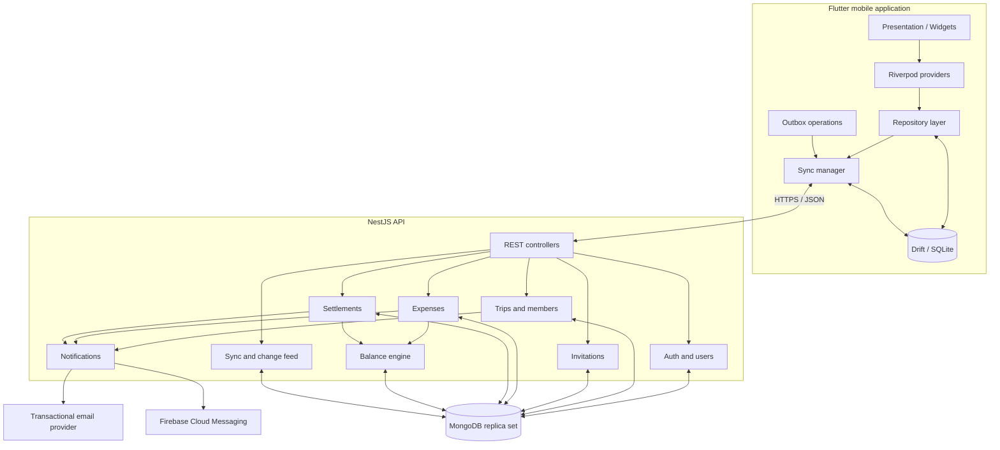
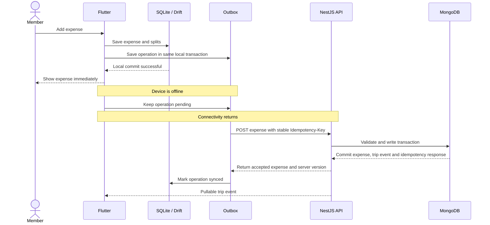

# Trip Expense Manager — Flutter Implementation Plan

**Document type:** Product and technical implementation specification  
**Status:** Proposed MVP architecture  
**Primary client:** Flutter (Android and iOS)  
**Backend:** NestJS / Node.js  
**Database:** MongoDB (replica set; MongoDB Atlas recommended for production)  
**Local database:** SQLite with Drift  
**API style:** Versioned REST API  
**Initial currency:** INR, with one currency per trip  

---

## 1. Product overview

The Trip Expense Manager is an offline-first, collaborative expense application. A trip owner creates a trip, adds registered or guest participants, and records expenses paid by any participant. Each expense is split equally or by custom amounts. The application calculates each member's net balance and suggests transfers that settle the group with fewer payments.

The app must remain useful when a traveller has unreliable connectivity. Cached trips and expenses remain readable offline, and a member can add, edit or delete expenses involving already-cached participants. Local changes are saved immediately in SQLite and synchronized with the backend when connectivity returns.

### 1.1 Product goals

1. Let a user create and manage multiple trips.
2. Let a trip owner invite account holders by email.
3. Allow participants to be added as guests without requiring an account.
4. Let authorized account holders record expenses on behalf of any trip participant, including guests.
5. Support equal and custom expense splits.
6. Calculate accurate member balances and settlement suggestions.
7. Record and confirm settlements without counting settlements as new trip expenses.
8. Support reliable offline expense entry and eventual synchronization.
9. Preserve financial history when a member leaves or is removed.

### 1.2 Explicit MVP boundaries

Included:

- Email/password registration and login.
- Email verification and password reset.
- Trip creation, editing, listing and archiving.
- Registered and guest trip participants.
- Email-based trip invitations.
- Equal and custom expense splitting.
- Expense creation, editing, soft deletion and filtering.
- Member balances and settlement suggestions.
- Settlement recording, confirmation, rejection and cancellation.
- Local SQLite cache and offline expense outbox.
- Pull synchronization using a per-trip change feed.
- Conflict detection for concurrent expense edits.
- Basic dashboard and category/member summaries.
- Push notifications and transactional email for important events.

Deferred until after MVP:

- Receipt OCR and automatic receipt extraction.
- Automatic SMS, bank or UPI transaction detection.
- In-app payment processing or automatic UPI collection.
- Multi-currency expenses inside one trip and exchange-rate conversion.
- Itinerary, hotel, transport or ticket booking.
- Maps and live location sharing.
- Advanced recurring budgets and subscriptions.
- Social feed, comments and chat.
- Multi-payer expenses.
- Full offline membership administration and offline invitation acceptance.

---

## 2. Final product decisions

| Area | Decision |
|---|---|
| Mobile platform | Flutter for Android and iOS |
| State management | Riverpod |
| Navigation | GoRouter |
| Local database | SQLite through Drift |
| Networking | Dio |
| Backend | NestJS modular monolith |
| Database | MongoDB with Mongoose |
| IDs | UUID strings generated by the client for client-created entities |
| Authentication | Email/password, short-lived access tokens and rotating refresh tokens |
| Member types | Registered account member or guest member |
| Expense split types | Equal and custom |
| Expense payer | One payer per expense in MVP; payer can be a guest |
| Currency | One currency per trip; INR initially |
| Money representation | Integer minor units (paise for INR) |
| Offline write pattern | Local-first write plus transactional outbox |
| Remote synchronization | Idempotent REST writes plus per-trip change feed |
| Concurrent edit handling | Optimistic version checks and explicit conflict state |
| Backend deployment | One NestJS API service and managed MongoDB replica set |

### 2.1 Registered members and guest members

There are two participant types:

**Registered member**

- Has a user account and can log in.
- Can access trips to which their account is linked.
- Can add expenses, view balances and synchronize their own device, subject to their trip role.
- Can receive invitations and notifications.

**Guest member**

- Is represented by a trip member record, not a user account.
- Can be added by name without registration or an email address.
- Can be selected as the payer or included in expense splits.
- Cannot log in, independently synchronize a device, or receive authenticated push notifications.
- Has expenses recorded by an authenticated trip member.

A guest's displayed name is not proof that the guest personally entered or confirmed a payment. The UI must distinguish **“Paid by Rahul (guest)”** from **“Recorded by Deep”** where appropriate.

### 2.2 Optional account conversion

A guest may later become a registered member. Do not create a second member automatically. Provide a controlled claim/link flow:

1. The guest registers and verifies their email address.
2. If the guest member record has that same normalized email, the account can request to claim the existing membership.
3. The server verifies the email and links `userId` to the existing member record, preserving its member ID and expense history.
4. If the guest member has no email, an owner/admin must send an invitation to the new account email and approve or initiate the link.
5. Prevent one user from being linked to two active membership records in the same trip.

For the first cut, guest conversion can be a later MVP sub-feature, but the schema should support it from the beginning.

---

## 3. Architecture overview

Use a **modular monolith** for the NestJS backend. Authentication, trips, members, invitations, expenses, balances, settlements and synchronization are separate modules in one deployable backend. Microservices are not required for this product's initial scale.



### 3.1 Source-of-truth responsibilities

- **MongoDB:** authoritative shared data and financial records.
- **SQLite:** device-local cache, locally pending changes and outbox operations.
- **NestJS:** authorization, validation, financial calculations, conflict detection and synchronization rules.
- **Flutter:** presentation and local interaction; it must not be trusted as the final authority for money or permissions.

### 3.2 Backend modules

```text
src/
├── main.ts
├── app.module.ts
├── common/
│   ├── decorators/
│   ├── guards/
│   ├── filters/
│   ├── interceptors/
│   ├── pipes/
│   └── utils/
├── config/
├── database/
│   ├── database.module.ts
│   ├── mongoose.module.ts
│   ├── models/
│   └── indexes/
├── auth/
├── users/
├── trips/
├── members/
├── invitations/
├── expenses/
├── balances/
├── settlements/
├── sync/
├── notifications/
└── health/
```

Each module should own its DTOs, controller, service, database schema/model and tests. Shared financial rules should live in a dedicated domain/service layer rather than being duplicated in controllers.

---

## 4. MongoDB data model

MongoDB is suitable for this application when the data model is designed around aggregate documents. The main design choice is to **embed expense splits inside the expense document**. An expense and its allocations are normally read and changed together, and embedding makes that operation atomic at the document level.

Keep trips, members, invitations, expenses, settlements and events as separate collections. Do not embed every trip expense or every member inside the trip document: those arrays can grow without bound and create document contention and document-size limits.

### 4.1 Collections

| Collection | Purpose |
|---|---|
| `users` | Registered accounts and profile information |
| `trips` | Trip metadata and synchronization version |
| `tripMembers` | Registered and guest participants in each trip |
| `tripInvitations` | Invitation tokens and invitation lifecycle |
| `expenses` | Expense details with embedded split allocations |
| `settlements` | Payment/settlement records |
| `tripEvents` | Append-only synchronization events |
| `refreshTokens` | Hashed refresh-token sessions |
| `idempotencyRecords` | Deduplication of retried write requests |

Use UUID strings for document `_id` values. This allows Flutter to create stable IDs while offline and send those same IDs to the backend later. The backend must still validate every ID and relationship; a client-generated UUID is an identifier, not an authorization mechanism.

### 4.2 `users` document

```json
{
  "_id": "user-uuid",
  "name": "Deep Mujpara",
  "email": "deep@example.com",
  "emailNormalized": "deep@example.com",
  "passwordHash": "<password-hash>",
  "emailVerifiedAt": "2026-11-04T12:00:00.000Z",
  "createdAt": "2026-11-04T11:00:00.000Z",
  "updatedAt": "2026-11-04T12:00:00.000Z"
}
```

Indexes:

- Unique index on `emailNormalized`.

Rules:

- Normalize email consistently before lookup or insertion.
- Never store plain-text passwords or invitation tokens.
- Use a suitable password hashing algorithm such as Argon2id or bcrypt with production-appropriate parameters.

### 4.3 `trips` document

```json
{
  "_id": "trip-uuid",
  "name": "Goa Trip 2026",
  "destination": "Goa, India",
  "description": "Year-end trip",
  "currency": "INR",
  "currencyExponent": 2,
  "startDate": "2026-12-15",
  "endDate": "2026-12-20",
  "createdByUserId": "user-uuid",
  "ownerUserId": "user-uuid",
  "syncVersion": 0,
  "archivedAt": null,
  "createdAt": "2026-11-04T12:00:00.000Z",
  "updatedAt": "2026-11-04T12:00:00.000Z"
}
```

Indexes:

- `{ ownerUserId: 1, archivedAt: 1, updatedAt: -1 }`
- `{ createdByUserId: 1 }`

The trip's `syncVersion` is incremented whenever a change-feed event is committed for that trip. Use a safe integer sequence and validate that it remains within JavaScript's safe integer range, or use BSON `Long` consistently if the sequence could exceed that range.

### 4.4 `tripMembers` document

```json
{
  "_id": "member-uuid",
  "tripId": "trip-uuid",
  "userId": "user-uuid-or-null",
  "displayName": "Rahul",
  "emailNormalized": "rahul@example.com",
  "memberKind": "guest",
  "role": "member",
  "status": "active",
  "createdByUserId": "owner-user-uuid",
  "joinedAt": null,
  "createdAt": "2026-11-04T12:00:00.000Z",
  "updatedAt": "2026-11-04T12:00:00.000Z"
}
```

Allowed values:

- `memberKind`: `account`, `guest`
- `role`: `owner`, `admin`, `member`
- `status`: `invited`, `active`, `left`, `removed`

Rules:

- `guest` records must have `userId: null`.
- An active `account` member must have a valid `userId`.
- An invitation can create an `account` member with `status: invited` and `userId: null` until it is accepted.
- A trip owner must be an account member.
- A removed member is retained for historical financial records.

Indexes:

- Unique partial index `{ tripId: 1, userId: 1 }` where `userId` is a string.
- Unique index `{ tripId: 1, emailNormalized: 1 }` where `emailNormalized` is a string, if the product chooses to prevent re-adding the same email as a second member. Re-adding should reactivate or reuse the historical member record rather than create duplicates.
- `{ tripId: 1, status: 1 }`
- `{ userId: 1, status: 1 }`

MongoDB partial indexes and Mongoose index declarations should be checked against the exact MongoDB server version used in production. If the intended unique partial index is not supported by the deployed version, perform the duplicate check transactionally and maintain a separate normalized membership key.

### 4.5 `tripInvitations` document

```json
{
  "_id": "invitation-uuid",
  "tripId": "trip-uuid",
  "memberId": "member-uuid",
  "invitedByUserId": "user-uuid",
  "emailNormalized": "rahul@example.com",
  "tokenHash": "<sha256-or-strong-hash-of-random-token>",
  "status": "pending",
  "expiresAt": "2026-11-11T12:00:00.000Z",
  "acceptedAt": null,
  "createdAt": "2026-11-04T12:00:00.000Z"
}
```

Allowed states: `pending`, `accepted`, `declined`, `revoked`, `expired`.

Indexes:

- Unique `{ tokenHash: 1 }`.
- `{ emailNormalized: 1, status: 1 }`.
- `{ tripId: 1, status: 1 }`.

Invitation tokens must be generated using a cryptographically secure random generator. Store only a hash of the token. Expiry must be checked when accepting; do not depend solely on a TTL index to enforce expiry. Retain invitation history for audit/support purposes.

### 4.6 `expenses` document with embedded splits

```json
{
  "_id": "expense-uuid",
  "tripId": "trip-uuid",
  "title": "Dinner",
  "amountMinor": 250000,
  "currency": "INR",
  "paidByMemberId": "member-deep-uuid",
  "createdByUserId": "user-deep-uuid",
  "splitType": "equal",
  "splits": [
    { "memberId": "member-deep-uuid", "amountMinor": 62500 },
    { "memberId": "member-rahul-uuid", "amountMinor": 62500 },
    { "memberId": "member-jay-uuid", "amountMinor": 62500 },
    { "memberId": "member-amit-uuid", "amountMinor": 62500 }
  ],
  "category": "food",
  "expenseDate": "2026-12-15",
  "description": "Dinner for the group",
  "status": "active",
  "version": 1,
  "clientCreatedAt": "2026-12-15T14:00:00.000Z",
  "createdAt": "2026-12-15T14:00:00.000Z",
  "updatedAt": "2026-12-15T14:00:00.000Z",
  "deletedAt": null
}
```

Allowed values:

- `splitType`: `equal`, `custom`
- `status`: `active`, `deleted`

Indexes:

- `{ tripId: 1, status: 1, expenseDate: -1, _id: -1 }`
- `{ tripId: 1, paidByMemberId: 1, expenseDate: -1 }`
- `{ tripId: 1, "splits.memberId": 1 }`

Validation rules:

1. `amountMinor` is a positive safe integer.
2. Every split amount is a non-negative safe integer.
3. The sum of all split amounts equals `amountMinor` exactly.
4. Every split member belongs to the same trip and is eligible for a new expense at the time of creation.
5. `paidByMemberId` belongs to the same trip.
6. The authenticated actor is authorized to create/edit this expense.
7. Only active expenses are included in spending and balance calculations.
8. An expense update increments `version`.
9. Deletion is a soft delete and increments `version`.

The payer may be a guest, but `createdByUserId` must identify the authenticated user who recorded the expense. This separates the claimed payer from the person who entered the data.

### 4.7 `settlements` document

```json
{
  "_id": "settlement-uuid",
  "tripId": "trip-uuid",
  "paidByMemberId": "member-rahul-uuid",
  "paidToMemberId": "member-deep-uuid",
  "amountMinor": 100000,
  "paymentDate": "2026-12-20",
  "status": "pending",
  "recordedByUserId": "user-rahul-uuid",
  "confirmedByUserId": null,
  "note": "UPI payment",
  "version": 1,
  "createdAt": "2026-12-20T12:00:00.000Z",
  "confirmedAt": null
}
```

Allowed states: `pending`, `confirmed`, `rejected`, `cancelled`.

Indexes:

- `{ tripId: 1, status: 1, paymentDate: -1 }`
- `{ tripId: 1, paidByMemberId: 1 }`
- `{ tripId: 1, paidToMemberId: 1 }`

Only confirmed settlements affect balances. The sender is `paidByMemberId`, and the receiver is `paidToMemberId`.

If the receiver is a registered member, that member should confirm the settlement. If the receiver is a guest, an owner/admin can confirm on the guest's behalf; the audit record must show which account performed the confirmation. The MVP records payments that happened outside the app; it does not move money or verify UPI transactions.

### 4.8 `tripEvents` change-feed document

```json
{
  "_id": "event-uuid",
  "tripId": "trip-uuid",
  "sequence": 27,
  "eventType": "expense.created",
  "entityType": "expense",
  "entityId": "expense-uuid",
  "actorUserId": "user-uuid",
  "payload": {
    "id": "expense-uuid",
    "title": "Dinner",
    "amountMinor": 250000,
    "version": 1
  },
  "createdAt": "2026-12-15T14:00:00.000Z"
}
```

Indexes:

- Unique `{ tripId: 1, sequence: 1 }`.
- `{ tripId: 1, createdAt: 1 }`.

Keep event payloads compact. Events should contain the information needed to update local projections, or a reference that instructs the client to fetch the latest entity. Do not put password hashes, refresh tokens, invitation secrets or other credentials in event payloads.

### 4.9 `refreshTokens` and `idempotencyRecords`

`refreshTokens`:

- `_id`, `userId`, `tokenHash`, `deviceId`, `expiresAt`, `revokedAt`, `createdAt`.
- Index unique `tokenHash`, plus `{ userId: 1, revokedAt: 1 }`.
- Store a hash, never the raw refresh token.

`idempotencyRecords`:

- `_id`, `actorUserId`, `idempotencyKey`, `requestHash`, `responseStatus`, `responseBody`, `createdAt`, `expiresAt`.
- Unique compound index `{ actorUserId: 1, idempotencyKey: 1 }`.
- Reuse of the same key with a different request hash must return a conflict.
- Retain records long enough to cover realistic offline retries. A TTL cleanup policy may be used after the retention period, but expiry must not undermine the retry window.

### 4.10 MongoDB transaction requirement

A single expense document write is atomic, including its embedded splits. However, a complete expense operation also needs to:

1. Validate the trip and member permissions.
2. Insert/update the expense document.
3. Increment the trip's `syncVersion`.
4. Insert a `tripEvents` record with the new sequence.
5. Store the idempotency response.

These are multiple documents. Use a MongoDB transaction so they succeed or fail together. **Multi-document transactions require a replica set or sharded cluster.** Use MongoDB Atlas or configure a replica set for local development and production. Do not build the production synchronization design around a standalone MongoDB server.

Use Mongoose sessions and `withTransaction`, with retry handling for transient transaction errors and write conflicts. Do not send email or push notifications inside a transaction callback: write a notification/outbox event transactionally, then dispatch it after commit.

---

## 5. Financial rules and calculation engine

Financial rules must be implemented on the backend and covered by automated tests. Flutter may show provisional local calculations, but the server response is authoritative.

### 5.1 Money representation

Store monetary amounts as integer minor units:

- INR ₹1.00 = `100` paise.
- INR ₹2,500.00 = `250000` paise.

Do not use binary floating-point values for financial calculations. In the Node.js implementation, validate every amount with `Number.isSafeInteger(value)` and set a product-appropriate maximum. If the application ever needs amounts beyond JavaScript's safe integer range, use BSON `Long` consistently and serialize it as a decimal string in JSON. Do not mix integer, floating-point and string representations casually.

A trip stores its currency code and currency exponent. All expenses in the trip use that currency in the MVP. Do not allow an expense to select another currency independently.

### 5.2 Balance formula

For each member:

```text
net balance = total expenses paid
            - total expense shares
            + confirmed settlements paid
            - confirmed settlements received
```

Interpretation:

- Positive balance: the member should receive money.
- Negative balance: the member owes money.
- Zero balance: the member is settled.

Pending, rejected and cancelled settlements do not affect balances. Deleted expenses do not affect balances.

The sum of balances for a trip must equal zero, provided all active expense amounts are fully allocated and every confirmed settlement has both a payer and receiver.

### 5.3 Equal split and paise remainder

For amount `A` and `N` participants:

```text
base = floor(A / N)
remainder = A % N
```

Allocate `base + 1` to the first `remainder` participants in a deterministic order, and `base` to the others. Use a stable ordering (for example, sorted member UUIDs) so a retry produces identical allocations. The exact total must always equal `A`.

Example: ₹100.00 = 10,000 paise shared by three members:

- Member A: 3,334 paise (₹33.34)
- Member B: 3,333 paise (₹33.33)
- Member C: 3,333 paise (₹33.33)

### 5.4 Custom split

The client submits the exact minor-unit share for each participant. The backend validates:

- No negative shares.
- No duplicate member IDs.
- Every member belongs to the same trip.
- Sum of shares exactly equals expense amount.
- Split list is not empty.

### 5.5 Settlement suggestion algorithm

1. Calculate all member net balances.
2. Put members with positive balances in a creditor list.
3. Put members with negative balances in a debtor list, using the absolute value.
4. Sort both lists by descending amount, with member ID as a deterministic tie-breaker.
5. Match the largest debtor and creditor for the smaller of their outstanding balances.
6. Reduce both balances and continue until all are zero.

This greedy algorithm creates at most `n - 1` transfers for a balanced group, although it does not guarantee a globally minimal number of transfers under every possible tie arrangement.

### 5.6 Balance calculation implementation approach

For an MVP-sized trip, use two MongoDB aggregation queries or fetch the trip's active expenses and confirmed settlements and compute an integer-based balance map in a domain service. Add pagination only to expense-history APIs; balance aggregation must consider all relevant records.

For larger trips, implement indexed aggregation pipelines:

- Expense payer contribution: `+ amountMinor` for `paidByMemberId`.
- Expense split contribution: `- split.amountMinor` for each split member.
- Settlement sender contribution: `+ amountMinor` for `paidByMemberId`.
- Settlement receiver contribution: `- amountMinor` for `paidToMemberId`.

Merge these contributions by member ID. Assert that the sum is zero before returning the balance response. If it is not zero, log a high-severity integrity error and do not silently display a seemingly valid result.

---

## 6. API specification

Base URL:

```text
https://api.example.com/v1
```

Use JSON request/response bodies, HTTPS only and a consistent error structure.

Success:

```json
{
  "success": true,
  "data": {},
  "message": "Operation completed successfully"
}
```

Error:

```json
{
  "success": false,
  "error": {
    "code": "EXPENSE_SPLIT_MISMATCH",
    "message": "Expense splits must equal the total amount"
  }
}
```

### 6.1 Authentication and profile

| Method | Endpoint | Purpose |
|---|---|---|
| POST | `/auth/register` | Create account |
| POST | `/auth/login` | Login |
| POST | `/auth/refresh` | Rotate refresh token and issue access token |
| POST | `/auth/logout` | Revoke current refresh session |
| POST | `/auth/verify-email` | Verify email using a one-time token/code |
| POST | `/auth/forgot-password` | Request password reset |
| POST | `/auth/reset-password` | Complete password reset |
| GET | `/users/me` | Get current profile |
| PATCH | `/users/me` | Update profile |

### 6.2 Trips

| Method | Endpoint | Purpose |
|---|---|---|
| POST | `/trips` | Create trip and owner membership atomically |
| GET | `/trips` | List trips for authenticated user |
| GET | `/trips/:tripId` | Get trip details |
| PATCH | `/trips/:tripId` | Update trip metadata |
| POST | `/trips/:tripId/archive` | Archive trip |
| POST | `/trips/:tripId/unarchive` | Restore archived trip |
| GET | `/trips/:tripId/summary` | Dashboard totals and category summary |

### 6.3 Members

| Method | Endpoint | Purpose |
|---|---|---|
| GET | `/trips/:tripId/members` | List members |
| POST | `/trips/:tripId/members` | Add guest member |
| PATCH | `/trips/:tripId/members/:memberId` | Update display name/details |
| PATCH | `/trips/:tripId/members/:memberId/role` | Change role |
| POST | `/trips/:tripId/members/:memberId/remove` | Remove/deactivate member |
| POST | `/trips/:tripId/members/:memberId/claim` | Link verified account to guest member |

Example guest request:

```json
{
  "displayName": "Rahul",
  "memberKind": "guest"
}
```

### 6.4 Invitations

| Method | Endpoint | Purpose |
|---|---|---|
| POST | `/trips/:tripId/invitations` | Invite email address |
| GET | `/invitations` | List invitations for current account |
| POST | `/invitations/:invitationId/resend` | Resend invitation |
| POST | `/invitations/:invitationId/revoke` | Revoke invitation |
| POST | `/invitations/accept` | Accept invitation with secure token |
| POST | `/invitations/decline` | Decline invitation |

Example:

```json
{
  "email": "rahul@example.com"
}
```

An invitation creates a pending account membership and a hashed, expiring token. Acceptance requires an authenticated account whose verified normalized email matches the invited email. The backend must verify expiry, status and membership uniqueness before linking the user to the member record.

### 6.5 Expenses

| Method | Endpoint | Purpose |
|---|---|---|
| POST | `/trips/:tripId/expenses` | Create expense |
| GET | `/trips/:tripId/expenses` | List expenses with pagination/filters |
| GET | `/trips/:tripId/expenses/:expenseId` | Get expense details |
| PATCH | `/trips/:tripId/expenses/:expenseId` | Update expense using expected version |
| DELETE | `/trips/:tripId/expenses/:expenseId` | Soft-delete expense using expected version |

Example creation request:

```json
{
  "id": "expense-uuid-generated-on-device",
  "title": "Dinner",
  "amountMinor": 250000,
  "paidByMemberId": "member-deep-uuid",
  "splitType": "equal",
  "participantMemberIds": [
    "member-deep-uuid",
    "member-rahul-uuid",
    "member-jay-uuid",
    "member-amit-uuid"
  ],
  "expenseDate": "2026-12-15",
  "category": "food",
  "description": "Dinner for the group"
}
```

For an equal split, the backend calculates the exact allocations. The client may display a preview, but it should not be the authority. For a custom split:

```json
{
  "id": "expense-uuid-generated-on-device",
  "title": "Hotel",
  "amountMinor": 500000,
  "paidByMemberId": "member-deep-uuid",
  "splitType": "custom",
  "splits": [
    { "memberId": "member-deep-uuid", "amountMinor": 200000 },
    { "memberId": "member-rahul-uuid", "amountMinor": 150000 },
    { "memberId": "member-jay-uuid", "amountMinor": 100000 },
    { "memberId": "member-amit-uuid", "amountMinor": 50000 }
  ],
  "expenseDate": "2026-12-15",
  "category": "stay"
}
```

For a retriable write, send:

```http
Idempotency-Key: <stable-outbox-operation-uuid>
```

For updates/deletes, include the expected `version` in the request or use an `If-Match` version header. A stale version returns HTTP `409 Conflict` with the latest server version or a reference that lets the client fetch it.

### 6.6 Balances and settlements

| Method | Endpoint | Purpose |
|---|---|---|
| GET | `/trips/:tripId/balances` | Get member balances |
| GET | `/trips/:tripId/settlement-suggestions` | Get suggested transfers |
| POST | `/trips/:tripId/settlements` | Record a payment |
| GET | `/trips/:tripId/settlements` | List settlements |
| POST | `/trips/:tripId/settlements/:settlementId/confirm` | Confirm payment |
| POST | `/trips/:tripId/settlements/:settlementId/reject` | Reject payment |
| POST | `/trips/:tripId/settlements/:settlementId/cancel` | Cancel pending payment |

Example:

```json
{
  "id": "settlement-uuid",
  "paidByMemberId": "member-rahul-uuid",
  "paidToMemberId": "member-deep-uuid",
  "amountMinor": 100000,
  "paymentDate": "2026-12-20",
  "note": "UPI payment"
}
```

Only confirmed settlements affect calculated balances. The backend must verify that both participants belong to the trip, are eligible under the settlement rules, and that the requested state transition is permitted.

### 6.7 Synchronization APIs

| Method | Endpoint | Purpose |
|---|---|---|
| GET | `/trips/:tripId/changes?after=<sequence>&limit=<n>` | Pull events after a cursor |
| GET | `/trips/:tripId/sync-status` | Get current server sequence and sync metadata |

Example change-feed response:

```json
{
  "changes": [
    {
      "sequence": 26,
      "eventType": "expense.created",
      "entityType": "expense",
      "entityId": "expense-uuid",
      "payload": {
        "id": "expense-uuid",
        "title": "Lunch",
        "amountMinor": 120000,
        "version": 1
      }
    }
  ],
  "nextCursor": 26,
  "hasMore": false
}
```

The client stores the returned entities and advances its cursor in one local SQLite transaction. If events are filtered or the server cannot provide a contiguous usable feed, the API must explicitly instruct the client to perform a full trip resync rather than silently skipping changes.

### 6.8 Pagination and filtering

Expense listing should support:

- `limit` with a sensible maximum (for example, 100).
- Cursor-based pagination.
- `fromDate` and `toDate`.
- `category`.
- `memberId` (payer or participant).
- `status` only for authorized administrative views.

Use stable cursor pagination, not large `skip` offsets, for growing expense histories.

---

## 7. Backend implementation details

### 7.1 Suggested dependencies

Install current compatible versions and commit the lockfile:

```bash
npm install @nestjs/config @nestjs/mongoose mongoose
npm install class-validator class-transformer
npm install argon2 @nestjs/jwt passport passport-jwt
npm install helmet @nestjs/throttler
npm install
```

Optional infrastructure packages:

```bash
npm install @nestjs/event-emitter
npm install firebase-admin
```

Use a transaction-capable MongoDB deployment. Keep secrets in environment variables or a secrets manager, never in source control.

### 7.2 Mongoose model conventions

- Use explicit schema definitions and DTO validation.
- Disable accidental mass assignment; map permitted DTO fields explicitly.
- Use timestamps consistently.
- Define indexes in code and deploy them deliberately.
- Avoid relying on Mongoose `populate()` as a substitute for authorization checks.
- Use `strict` schema mode and explicit enums/validators.
- Use lean reads for high-volume read paths where appropriate.
- Use sessions for multi-document transactions.
- Keep collection model names and index names stable.

### 7.3 Example Mongoose expense schema

The following is a structural example; production code should split schemas, DTOs, domain types and validation into separate files.

```ts
import { Prop, Schema, SchemaFactory } from '@nestjs/mongoose';
import { HydratedDocument } from 'mongoose';

@Schema({ _id: false })
export class ExpenseSplit {
  @Prop({ type: String, required: true })
  memberId!: string;

  @Prop({ type: Number, required: true, min: 0 })
  amountMinor!: number;
}

export const ExpenseSplitSchema = SchemaFactory.createForClass(ExpenseSplit);

@Schema({ timestamps: true, versionKey: false, collection: 'expenses' })
export class Expense {
  @Prop({ type: String, required: true, unique: true })
  _id!: string;

  @Prop({ type: String, required: true, index: true })
  tripId!: string;

  @Prop({ type: String, required: true, maxlength: 200 })
  title!: string;

  @Prop({ type: Number, required: true, min: 1 })
  amountMinor!: number;

  @Prop({ type: String, required: true })
  paidByMemberId!: string;

  @Prop({ type: String, required: true })
  createdByUserId!: string;

  @Prop({ type: String, enum: ['equal', 'custom'], required: true })
  splitType!: 'equal' | 'custom';

  @Prop({ type: [ExpenseSplitSchema], required: true })
  splits!: ExpenseSplit[];

  @Prop({ type: String, required: true })
  expenseDate!: string;

  @Prop({ type: String, default: 'other' })
  category!: string;

  @Prop({ type: String, enum: ['active', 'deleted'], default: 'active' })
  status!: 'active' | 'deleted';

  @Prop({ type: Number, required: true, default: 1, min: 1 })
  version!: number;

  @Prop({ type: Date, default: null })
  deletedAt!: Date | null;
}

export type ExpenseDocument = HydratedDocument<Expense>;
export const ExpenseSchema = SchemaFactory.createForClass(Expense);

ExpenseSchema.index({ tripId: 1, status: 1, expenseDate: -1, _id: -1 });
ExpenseSchema.index({ tripId: 1, paidByMemberId: 1, expenseDate: -1 });
ExpenseSchema.index({ tripId: 1, 'splits.memberId': 1 });
```

Do not depend only on the Mongoose schema's `min` validation for financial invariants. In the domain service, validate safe integers, member ownership, duplicate split members, sum equality and permissions before writing.

### 7.4 Transaction pattern for creating an expense

Recommended logical flow:

1. Authenticate the user.
2. Begin MongoDB session/transaction.
3. Look up the idempotency key for the actor.
4. If the key exists with the same request hash, return the stored response.
5. If the key exists with a different hash, return `409 IDEMPOTENCY_KEY_REUSED`.
6. Load trip and verify that the actor is an active member with create-expense permission.
7. Load payer and all split members; verify they belong to the same trip and are eligible.
8. Calculate equal allocations or validate custom allocations.
9. Insert the expense document with embedded splits.
10. Atomically increment the trip's `syncVersion` and obtain the new sequence.
11. Insert the corresponding `tripEvents` document.
12. Insert the idempotency record with the response.
13. Commit the transaction.
14. Dispatch any notification after commit through a reliable background/outbox mechanism.

Retry transient transaction errors with bounded retries. Do not retry arbitrary validation or authorization errors.

### 7.5 MongoDB validation and referential integrity

MongoDB does not provide relational foreign keys. Implement these checks in services and, where practical, add MongoDB collection validators:

- `tripId` exists and is accessible to the actor.
- Member IDs used as payer/split recipients belong to the same trip.
- A referenced user exists when linking an account member.
- Only one active membership per user per trip.
- A trip has exactly one owner membership.
- Invitation and member email identities match during acceptance.
- Settlement participants belong to the same trip.
- Expense splits reconcile exactly to the expense amount.

Perform critical multi-document validations and writes inside transactions to reduce race conditions. MongoDB indexes help uniqueness, but indexes are not a substitute for authorization.

### 7.6 Trip sequence allocation

When writing an event, increment the trip document's `syncVersion` inside the same transaction and use the returned value as the event sequence:

```text
trip.syncVersion: 41 -> 42
tripEvents.insert({ tripId, sequence: 42, ... })
```

The update and event insert must be in the same transaction. This provides an ordered per-trip cursor. If two writes race, MongoDB transaction/write-conflict handling must retry one operation so sequence allocation remains consistent.

---

## 8. Flutter architecture

Use a feature-first, layered structure. Screens must not call Dio or Drift directly. Screens interact with Riverpod providers/notifiers and repository interfaces. Repositories decide whether to read/write local data or call the remote API.

### 8.1 Recommended packages

| Package | Purpose |
|---|---|
| `flutter_riverpod` | State management and dependency injection |
| `drift` | Typed SQLite database layer |
| `drift_flutter` | Flutter integration for Drift |
| `dio` | HTTP client |
| `connectivity_plus` | Connectivity-change signals |
| `flutter_secure_storage` | Store refresh token securely |
| `uuid` | Generate stable IDs for offline-created records |
| `go_router` | Navigation and route guards |
| `intl` | Date and currency formatting |
| `json_annotation` / `json_serializable` | JSON mapping, if desired |
| `freezed` | Immutable models and unions, if desired |
| `firebase_messaging` | Push notifications |
| `path_provider` | App-specific file paths if needed |

Pin compatible versions in `pubspec.lock`; do not copy version numbers from old examples without checking compatibility.

### 8.2 Flutter project structure

```text
lib/
├── main.dart
├── app/
│   ├── app.dart
│   ├── router.dart
│   ├── theme/
│   └── bootstrap.dart
├── core/
│   ├── database/
│   │   ├── app_database.dart
│   │   ├── tables/
│   │   └── migrations/
│   ├── network/
│   │   ├── dio_client.dart
│   │   ├── api_interceptors.dart
│   │   └── api_result.dart
│   ├── sync/
│   │   ├── sync_manager.dart
│   │   ├── outbox_processor.dart
│   │   ├── change_puller.dart
│   │   ├── sync_scheduler.dart
│   │   └── conflict_handler.dart
│   ├── secure_storage/
│   ├── errors/
│   └── utils/
├── features/
│   ├── auth/
│   │   ├── data/
│   │   ├── domain/
│   │   └── presentation/
│   ├── trips/
│   ├── members/
│   ├── invitations/
│   ├── expenses/
│   ├── balances/
│   ├── settlements/
│   ├── dashboard/
│   ├── notifications/
│   └── profile/
└── shared/
    ├── widgets/
    ├── models/
    └── extensions/
```

Each feature should contain:

- `domain`: entities, repository interfaces and use cases.
- `data`: DTOs, API data sources, Drift data sources and repository implementations.
- `presentation`: screens, widgets, providers/notifiers and UI state.

### 8.3 Local-first repository pattern

Example expense repository contract:

```dart
abstract interface class ExpenseRepository {
  Stream<List<Expense>> watchExpenses(String tripId);
  Future<Expense?> getExpense(String expenseId);
  Future<void> createExpense(CreateExpenseInput input);
  Future<void> updateExpense(UpdateExpenseInput input);
  Future<void> deleteExpense(DeleteExpenseInput input);
}
```

The implementation should:

- Validate user input for immediate feedback.
- Save the expense and splits to SQLite in one local transaction.
- Insert an outbox operation in that same local transaction.
- Return to the UI immediately after the local commit.
- Let the sync manager send the operation later.
- Update local server version and sync status after acknowledgment.

Do not wait for the backend before displaying a successfully committed local expense.

---

## 9. Local SQLite / Drift model

The local database is a projection of data the signed-in user is allowed to access, plus pending local work. It is not the authoritative shared database.

### 9.1 Local tables

| Table | Purpose |
|---|---|
| `local_trips` | Cached trip metadata and server sync version |
| `local_members` | Cached trip members |
| `local_expenses` | Cached/local expense documents |
| `local_expense_splits` | Local split allocations |
| `local_settlements` | Cached and pending settlements |
| `outbox_operations` | Durable pending writes |
| `sync_cursors` | Last applied event sequence per trip |
| `sync_conflicts` | Changes requiring user review |

### 9.2 Conceptual SQLite schema

```sql
CREATE TABLE local_trips (
  id TEXT PRIMARY KEY,
  name TEXT NOT NULL,
  destination TEXT,
  currency TEXT NOT NULL,
  currency_exponent INTEGER NOT NULL,
  server_sync_version INTEGER NOT NULL DEFAULT 0,
  cached_at TEXT NOT NULL
);

CREATE TABLE local_members (
  id TEXT PRIMARY KEY,
  trip_id TEXT NOT NULL,
  user_id TEXT,
  display_name TEXT NOT NULL,
  member_kind TEXT NOT NULL,
  role TEXT NOT NULL,
  status TEXT NOT NULL
);

CREATE TABLE local_expenses (
  id TEXT PRIMARY KEY,
  trip_id TEXT NOT NULL,
  paid_by_member_id TEXT NOT NULL,
  created_by_user_id TEXT,
  title TEXT NOT NULL,
  amount_minor INTEGER NOT NULL,
  split_type TEXT NOT NULL,
  category TEXT NOT NULL,
  expense_date TEXT NOT NULL,
  version INTEGER NOT NULL DEFAULT 1,
  sync_status TEXT NOT NULL DEFAULT 'synced',
  deleted_at TEXT
);

CREATE TABLE local_expense_splits (
  expense_id TEXT NOT NULL,
  member_id TEXT NOT NULL,
  amount_minor INTEGER NOT NULL,
  PRIMARY KEY (expense_id, member_id)
);

CREATE TABLE local_settlements (
  id TEXT PRIMARY KEY,
  trip_id TEXT NOT NULL,
  paid_by_member_id TEXT NOT NULL,
  paid_to_member_id TEXT NOT NULL,
  amount_minor INTEGER NOT NULL,
  status TEXT NOT NULL,
  sync_status TEXT NOT NULL DEFAULT 'synced'
);

CREATE TABLE outbox_operations (
  id TEXT PRIMARY KEY,
  trip_id TEXT NOT NULL,
  operation_type TEXT NOT NULL,
  method TEXT NOT NULL,
  endpoint TEXT NOT NULL,
  payload TEXT NOT NULL,
  base_version INTEGER,
  state TEXT NOT NULL DEFAULT 'pending',
  attempt_count INTEGER NOT NULL DEFAULT 0,
  next_attempt_at TEXT,
  last_error TEXT,
  created_at TEXT NOT NULL
);

CREATE TABLE sync_cursors (
  trip_id TEXT PRIMARY KEY,
  last_sequence INTEGER NOT NULL DEFAULT 0
);
```

Implement actual tables using Drift table classes and generated code. Add indexes for trip/date expense queries, member lookups, and pending outbox operations. Use Drift migrations for schema changes. Never wipe a user's local database as a shortcut during normal app upgrades.

### 9.3 Local transaction rule

For an expense create/update/delete, one SQLite transaction must update:

1. Expense row.
2. Split rows.
3. Outbox operation.

This ensures the app cannot show a locally saved expense without also preserving the operation needed to synchronize it.

---

## 10. Offline synchronization design

### 10.1 Core pattern

Use a **transactional local outbox + idempotent REST writes + server change feed**.

- Outbox: records local changes that still need to reach the server.
- Idempotency: makes retries safe.
- Change feed: imports changes made by other trip members.
- Version checks: detect concurrent edits.
- SQLite transactions: apply each incoming event and cursor update atomically.

### 10.2 Expense write while offline



### 10.3 Outbox operation shape

```json
{
  "id": "operation-uuid",
  "tripId": "trip-uuid",
  "operationType": "create_expense",
  "method": "POST",
  "endpoint": "/v1/trips/trip-uuid/expenses",
  "payload": {
    "id": "expense-uuid",
    "title": "Lunch",
    "amountMinor": 120000
  },
  "baseVersion": null,
  "state": "pending",
  "attemptCount": 0
}
```

The operation ID is the idempotency key. Reuse it for every retry of that logical operation. Do not create a new key when a request times out or the response is lost.

### 10.4 Sync lifecycle

Trigger synchronization:

- On successful login/session restoration.
- When the app resumes from background.
- When connectivity changes from unavailable to available.
- After a local write, if the device appears online.
- On user-requested refresh.
- Periodically while the app is active, subject to battery/network considerations.

Suggested cycle:

1. Verify that the user session is valid.
2. Check API reachability; connectivity state alone is not enough.
3. Pull changes since the last cursor to refresh remote state.
4. Process pending outbox operations in creation order per trip.
5. Send one operation at a time per trip initially; different trips may sync concurrently with a safe global limit.
6. Mark successful operations synced using the server response.
7. Mark conflicts for user review; do not retry them forever.
8. Retry transient network/server failures with exponential backoff and jitter.
9. Pull changes again to import changes produced by other members and the current device.
10. Persist entity updates and the new cursor in local transactions.

If an operation is left in `inFlight` when the app terminates, return it to `pending` on startup. An operation must not be lost because a process was killed.

### 10.5 Change feed sequence

Each successful trip mutation increments `trips.syncVersion` and inserts a `tripEvents` row in the same MongoDB transaction. The API returns events ordered by `sequence`.

Example:

```json
{
  "changes": [
    {
      "sequence": 28,
      "eventType": "expense.updated",
      "entityType": "expense",
      "entityId": "expense-uuid",
      "payload": {
        "id": "expense-uuid",
        "version": 2,
        "title": "Dinner at restaurant"
      }
    }
  ],
  "nextCursor": 28,
  "hasMore": false
}
```

The client must:

- Apply each event idempotently.
- Ignore an event it has already applied.
- Validate expected entity/version progression where relevant.
- Update the cursor in the same SQLite transaction as the event application.
- Request a full resync if the server indicates that the cursor is no longer available or the local projection is inconsistent.

### 10.6 Conflict handling

Every synchronized expense has a server `version`.

Example:

1. Device A downloads version 4.
2. Device A edits offline using `baseVersion = 4`.
3. Device B changes the expense online; server version becomes 5.
4. Device A reconnects and submits its edit based on version 4.
5. Server returns `409 Conflict` with current version 5.
6. Flutter stores a conflict record and shows the user the local and server versions.

MVP resolution choices:

- Keep server version.
- Apply local changes on top of the server version after review.
- Re-enter the intended changes as a new update using the latest version.

Do not silently use last-write-wins for expense amount, payer or split changes.

### 10.7 Offline capability matrix

| Function | Offline behaviour in MVP |
|---|---|
| View cached trips | Yes |
| View cached members | Yes |
| View cached expenses | Yes |
| Add expense for cached participants | Yes |
| Edit cached expense | Yes, with version conflict detection |
| Delete cached expense | Yes, soft-delete operation queued |
| Calculate provisional balances | Yes, label as provisional |
| Create trip | Online only initially |
| Add/remove trip members | Online only |
| Send/accept invitations | Online only |
| Record settlement | May queue as pending; server validates on sync |
| Confirm/reject settlement | Online only initially |
| Upload receipt | Later feature; queue upload metadata only after upload design exists |

Important limitation: a member removed while another device is offline cannot be remotely locked out until that device reconnects. At the next successful sync, the app must detect revoked membership, stop future sync, and clear or lock private trip cache according to the product's data-retention policy. Explain that cached data cannot be remotely revoked while a device is fully offline.

---

## 11. Application screens and user flows

### 11.1 Top-level navigation

Use four main destinations:

1. **Home:** active trips, completed trips and pending invitations.
2. **Expenses:** recent expenses across the selected trip or current context.
3. **Balances:** amounts owed/receivable for the selected trip.
4. **Profile:** profile, security and app settings.

Inside a selected trip, show nested sections:

- Overview
- Expenses
- Members
- Balances / Settlements

Keep an obvious Add Expense action accessible from the trip overview and expense screen.

### 11.2 Screens

| Screen | Main functionality |
|---|---|
| Splash/bootstrap | Load local session and database |
| Login | Email and password |
| Registration | Name, email and password |
| Email verification | Verify account email |
| Forgot password | Reset flow |
| Home | Trips, invitations and sync status |
| Create trip | Name, destination, dates and currency |
| Trip overview | Total spending, member count, categories and recent activity |
| Members | Add guest, invite by email, role/status management |
| Invitation details | Accept or decline invitation |
| Add/edit expense | Amount, payer, split method, participants and category |
| Expense details | Payer, split list, creator, date and edit history |
| Expense history | Filter and paginate expenses |
| Balances | Member balances and suggested settlements |
| Record settlement | Payer, receiver, amount, date and note |
| Settlement details | Pending/confirmed/rejected state and confirmation action |
| Profile/settings | Account details, logout, notification preferences |
| Sync issues | Pending operations and conflicts that need attention |

### 11.3 Expense form UX

Recommended fields/order:

1. Amount and currency.
2. Expense title.
3. Paid by (any active trip participant, including guest).
4. Split method: Equal or Custom.
5. Participants included in the split.
6. Custom amounts, if selected.
7. Category.
8. Date.
9. Optional description.
10. Save.

Show a live split preview. The preview is for usability; the backend revalidates or recalculates the final allocations.

### 11.4 Sync indicator

Expose clear states:

- **Synced:** server confirmed.
- **Pending sync:** saved locally and waiting for server.
- **Syncing:** request in progress.
- **Conflict:** remote and local versions differ.
- **Failed:** operation needs retry or user action.

When balances include pending local expenses, label them as **provisional** or **including unsynced changes**. Do not present a local provisional value as a server-confirmed settlement amount.

---

## 12. Permissions and security model

### 12.1 Roles

| Action | Owner | Admin | Member |
|---|---:|---:|---:|
| View trip | Yes | Yes | Yes |
| Add expense | Yes | Yes | Yes |
| Edit own expense | Yes | Yes | Yes |
| Edit another member's expense | Yes | Yes, if enabled | No by default |
| Delete another member's expense | Yes | Yes, if enabled | No by default |
| Add/remove guest | Yes | Yes | No |
| Invite by email | Yes | Yes | Optional product policy; default no |
| Change member roles | Yes | Limited; cannot assign owner | No |
| Transfer ownership | Yes | No | No |
| Archive trip | Yes | No | No |
| Confirm settlement addressed to self | Yes, if receiver | Yes, if receiver or guest receiver | Yes, if receiver |

The final permission policy should be enforced centrally in NestJS guards/services. Do not rely on UI visibility.

### 12.2 Security checklist

- HTTPS for every API request.
- Strong password hashing (Argon2id or bcrypt).
- Short-lived access tokens.
- Rotating refresh tokens with server-side revocation.
- Store refresh tokens using Flutter secure storage.
- Verify email ownership before accepting an invitation.
- Random, expiring, single-use invitation tokens; store hashes only.
- DTO validation and strict property allowlists.
- Rate limits on login, password reset and invitation endpoints.
- Authorization checks on every trip-scoped resource.
- Prevent insecure direct object reference (IDOR/BOLA) attacks.
- Validate same-trip membership for payer, split and settlement references.
- Idempotency protection for retried writes.
- Audit trail for important membership, expense and settlement changes.
- Do not log credentials, tokens, complete invitation links or unnecessary personal data.
- Restrict file upload types and sizes if receipts are added later.
- Back up the database and test restoration.

### 12.3 Guest-specific security

A guest has no credentials and cannot call authenticated APIs. All actions involving a guest are performed by an authenticated member with appropriate trip permissions. The UI should preserve both identities:

- `paidByMemberId`: person recorded as having paid.
- `createdByUserId`: account holder who entered the expense.

This is important for auditability and dispute resolution.

---

## 13. Testing strategy

Financial logic, access control and offline synchronization are release-blocking areas.

### 13.1 Financial unit tests

| Test | Expected result |
|---|---|
| ₹1,000 split equally among 4 | ₹250 per member |
| ₹100 split equally among 3 | ₹33.34, ₹33.33, ₹33.33 |
| Custom splits total correctly | Save succeeds |
| Custom split sum is too low/high | Save rejected |
| Duplicate member in split | Save rejected |
| Member from another trip is included | Save rejected |
| Guest is selected as payer | Allowed when actor has permission |
| Expense is soft-deleted | Excluded from balances |
| Settlement is pending | No balance effect |
| Settlement is confirmed | Sender and receiver balances update |
| All valid trip entries are included | Sum of balances is zero |

Use property-based/randomized tests to generate many groups, expenses and allocations and assert the sum-of-balances invariant.

### 13.2 Backend integration tests

- Create trip and owner member in one transaction.
- Add guest and account member.
- Create invitation and accept with correct verified email.
- Reject expired/revoked/reused invitation.
- Create expense with embedded splits.
- Reject mismatched split total.
- Retry same idempotency key and receive same result without duplicate expense.
- Reuse key with different payload and receive conflict.
- Race two trip mutations and verify unique sequence numbers.
- Reject stale expense version.
- Confirm settlement and verify balances.
- Verify every trip-scoped endpoint enforces membership.
- Run transaction tests against a replica set, not a standalone MongoDB test server.

### 13.3 Flutter tests

- Widget tests for login, trip list, expense form and balance view.
- Repository tests using a temporary Drift database.
- Local transaction test: expense, splits and outbox are all saved or none are saved.
- App restart test: pending outbox survives process termination.
- Sync manager test with mocked API failures and retries.
- Event pull test with duplicate and out-of-order event delivery.
- Conflict UI test.
- Secure storage/session restoration test.

### 13.4 End-to-end offline tests

1. Sign in and sync a trip.
2. Cache members and expenses.
3. Enable airplane mode.
4. Create an expense for cached members.
5. Force-close and reopen the app.
6. Verify expense and pending operation remain.
7. Restore connectivity.
8. Verify server receives exactly one expense.
9. Open the same trip on another device/account.
10. Verify the new expense appears.
11. Edit the same expense offline on two devices.
12. Verify stale write is detected and user is shown a conflict.

### 13.5 Security tests

- Non-member attempts to read trip by guessing/changing UUID.
- Member attempts to access another trip's expense ID.
- Guest attempts to authenticate.
- Removed member attempts a new write.
- Unverified account attempts invitation acceptance.
- Invitation token replay.
- Refresh token replay after rotation/revocation.
- Unauthorized role changes.
- Expense split contains a member from a different trip.
- Settlement uses unrelated payer/receiver IDs.

---

## 14. Development phases and deliverables

Build vertical slices where a feature works from UI through local storage, API and database. Establish the offline architecture at the beginning rather than postponing it.

### Phase 1 — Repository and infrastructure foundation

Backend:

- Create NestJS project.
- Configure environment validation.
- Configure MongoDB replica-set connection.
- Configure Mongoose models and index creation strategy.
- Add request validation, exception filters and logging.
- Add health/readiness endpoints.

Flutter:

- Create Flutter project.
- Configure Riverpod, GoRouter and app bootstrap.
- Configure Drift and local database migrations.
- Configure Dio and secure storage.
- Create base repository/result/error conventions.
- Create outbox and sync cursor tables.

Deliverable: Flutter app starts, NestJS API starts, MongoDB is reachable through a replica-set connection, and a local test record can be persisted in SQLite.

### Phase 2 — Authentication and accounts

- Register and login.
- Password hashing and email verification.
- Access and rotating refresh tokens.
- Logout and revocation.
- Forgot/reset password.
- Profile read/update.
- Authenticated API client and route guards.

Deliverable: User can register, verify, log in and restore a session securely.

### Phase 3 — Trips and membership

- Create trip and owner member in one transaction.
- List and view trips.
- Edit and archive trips.
- Add guest member.
- Invite by email.
- Accept/decline/revoke/resend invitations.
- List members and enforce roles.
- Cache trips and members in SQLite.

Deliverable: Owner can create a trip, add guests and invite account holders. Members can access only trips to which they belong.

### Phase 4 — Expenses and splits

- Build expense form and expense history.
- Implement equal split in domain layer.
- Implement custom split validation.
- Record payer separately from actor.
- Create expense document with embedded splits.
- Implement edit and soft delete with version checks.
- Store local expense, split preview and outbox operation atomically.

Deliverable: Expenses can be recorded online and offline; custom/equal allocations reconcile exactly.

### Phase 5 — Financial engine and settlements

- Calculate paid totals and shares.
- Calculate net balances.
- Assert balance sum equals zero.
- Implement suggested settlement transfers.
- Record settlement.
- Confirm/reject/cancel settlement.
- Track audit identity for guest-related actions.

Deliverable: Member balances and settlement flows produce correct results under automated tests.

### Phase 6 — Synchronization and conflict handling

- Implement transactional idempotency records.
- Implement per-trip sequence allocation.
- Write trip events for each relevant mutation.
- Implement push of outbox operations.
- Implement pull change feed.
- Implement retries and exponential backoff.
- Implement stale-version conflict detection.
- Implement conflict review UI and full-resync fallback.

Deliverable: Two devices converge after offline changes without duplicate expenses or silent overwrites.

### Phase 7 — Dashboard and notifications

- Trip overview cards and metrics.
- Category summary and member summary.
- Recent activity.
- Pending invitation view.
- FCM device token registration.
- Invitation, expense and settlement notifications.
- Notification preferences and deep links.

Deliverable: Users can understand trip spending and receive useful notifications.

### Phase 8 — Hardening and release

- Integration, security and E2E tests.
- Database indexes and query review.
- Logging, monitoring and alerts.
- Backups and restore test.
- Android/iOS release configuration.
- Privacy policy, terms and data deletion process.
- Store listing, screenshots and release testing.

Deliverable: A tested release candidate with operational monitoring and recovery procedures.

---

## 15. Deployment and operations

### 15.1 Suggested deployment components

| Component | Options |
|---|---|
| Flutter distribution | Google Play and Apple App Store |
| NestJS API | Render, Railway, VPS or managed container platform |
| MongoDB | MongoDB Atlas replica set |
| Email | Resend, Brevo or another transactional provider |
| Push | Firebase Cloud Messaging |
| Monitoring | Sentry or equivalent plus structured server logs |
| CI/CD | GitHub Actions |
| Secrets | Platform secret manager or dedicated vault |

### 15.2 Environment variables

Example backend configuration (use placeholders only in documentation):

```env
NODE_ENV=development
PORT=3000
API_PREFIX=v1
MONGODB_URI=mongodb://replica-set-connection-string
JWT_ACCESS_SECRET=<strong-random-secret>
JWT_ACCESS_TTL=15m
REFRESH_TOKEN_TTL_DAYS=30
APP_DEEP_LINK=https://app.example.com/invitations/accept
EMAIL_PROVIDER_API_KEY=<secret>
EMAIL_FROM=Trip App <no-reply@example.com>
FIREBASE_PROJECT_ID=<project-id>
```

Validate all required environment variables at startup. Use separate configuration for local, staging and production. Never commit real secrets.

### 15.3 MongoDB operational requirements

- Use a replica set for transactions.
- Configure automated backups and point-in-time recovery where available.
- Test restore procedures before release.
- Deploy indexes deliberately and monitor index build impact.
- Monitor slow queries, connection pool usage and transaction retries.
- Use least-privilege database credentials.
- Keep production data out of local development environments.
- Use migration scripts for schema/index changes; do not assume Mongoose auto-indexing is an adequate production migration strategy.

### 15.4 Observability

Track:

- API error rates and latency.
- Authentication failures and rate-limit activity.
- MongoDB connection and transaction errors.
- Idempotency replays and payload mismatch attempts.
- Outbox backlog and sync failure rate.
- Number and age of unresolved conflicts.
- Change-feed lag per trip/device.
- Expense/split invariant violations.
- Settlement state-transition failures.

Avoid logging complete financial histories or sensitive tokens by default. Use correlation IDs and entity IDs where appropriate.

---

## 16. MongoDB versus PostgreSQL: final evaluation

MongoDB can support the proposed product. The choice is not a blocker, but it changes how relationships, constraints and transactions are implemented.

| Concern | PostgreSQL | MongoDB design for this app |
|---|---|---|
| Trips and users | Foreign-key relationships | Separate collections and validated references |
| Trip members | Join table | `tripMembers` collection |
| Expense splits | Separate related rows | Embedded `splits` array inside expense |
| Split integrity | Constraints/transaction | Service validation plus one expense document and transaction |
| Balance calculation | SQL aggregation | Aggregation pipelines or domain service |
| Sync event order | Transactional sequence/event table | Trip sequence increment plus event document in transaction |
| Duplicate retry protection | Unique idempotency row | Unique idempotency document and transaction |
| Referential integrity | Database foreign keys | Application validation, indexes and transactions |
| Offline mobile support | Same client architecture | Same client architecture |

### 16.1 Advantages of MongoDB here

- Fits the NestJS/Node.js ecosystem and your existing MongoDB experience.
- An expense and its split allocations form a natural embedded document.
- Expense reads are straightforward because the payer and split information are in one document.
- A client-generated UUID can be used as the MongoDB document ID for offline-created expenses.
- Aggregation pipelines can calculate trip-level spending and member balances.

### 16.2 Trade-offs and risks

- There are no relational foreign keys; the service must validate every cross-document reference.
- Multi-document transactions require a replica set or sharded deployment.
- Unique indexes and partial-index behaviour need deliberate design.
- Cross-collection aggregates are more involved than a relational query.
- Schema and migration discipline still matters even though MongoDB is schema-flexible.
- Embedded arrays should be bounded; do not embed all expenses or all members in a trip document.

### 16.3 Recommendation

For this application, MongoDB is a reasonable choice if:

1. You use MongoDB Atlas or another replica-set deployment.
2. You embed splits within each expense document.
3. You validate member/trip references in NestJS services.
4. You use multi-document transactions for expense + event + idempotency writes.
5. You use integer minor units for all money calculations.
6. You implement the same offline outbox and version-conflict strategy regardless of database.

PostgreSQL remains a strong alternative if strict relational constraints and complex financial reporting become the dominant requirements. You do not need to switch to PostgreSQL solely because the application handles group expenses. A well-designed MongoDB implementation is viable for the defined MVP.

---

## 17. Definition of done for the MVP

The MVP is ready for controlled public testing only when all of the following are true:

### Product functionality

- A user can register, verify email and log in.
- A user can create multiple trips.
- A trip owner can add guests and invite people by email.
- An invited person can accept using the verified invited email.
- A user can see only trips they are authorized to access.
- Authorized members can create equal and custom expenses.
- A guest can be recorded as payer or split participant.
- An expense can be edited or soft-deleted without erasing historical audit information.
- Balances are correct and settlement suggestions reconcile.
- Pending settlements do not affect balances; confirmed settlements do.

### Offline functionality

- Cached trips, participants and expenses are readable offline.
- Expense create/edit/delete works offline for cached participants.
- Expense, split and outbox writes are atomic in SQLite.
- Pending operations survive an app restart.
- Retried writes do not create duplicate expenses.
- Remote changes are pulled using a durable cursor.
- Concurrent edits are detected and surfaced to users.
- Local provisional balances are clearly distinguished from confirmed server balances.

### Reliability and security

- Server validates every financial invariant.
- Every trip-scoped endpoint enforces membership and role permissions.
- Invitations are secure, expiring and single-use.
- MongoDB transaction tests run against a replica set.
- Database indexes are deployed and verified.
- Backups and data restoration are tested.
- Crash/error reporting and operational logs are enabled.
- Privacy policy, terms, and account/data deletion processes are ready.

---

## 18. Recommended first vertical slice

Build this complete flow before expanding the feature set:

1. Register and log in.
2. Create a trip.
3. Add one registered member and one guest.
4. Add a ₹500 expense paid by the owner.
5. Split the expense equally.
6. View the resulting balances.
7. Turn off internet access.
8. Add another expense using cached participants.
9. Force-close and reopen the app.
10. Restore connectivity.
11. Verify exactly one new expense exists on the server.
12. Open the trip on another device and verify the synchronized expense and balance.

This vertical slice validates the most important architecture decisions: authentication, membership, guest handling, MongoDB transactions, expense splitting, balance calculation, local persistence, outbox durability, idempotency and remote synchronization.

**Build this first, test it thoroughly, then expand feature by feature.**
